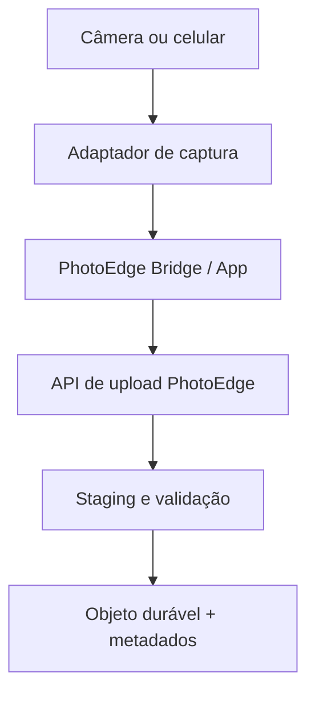
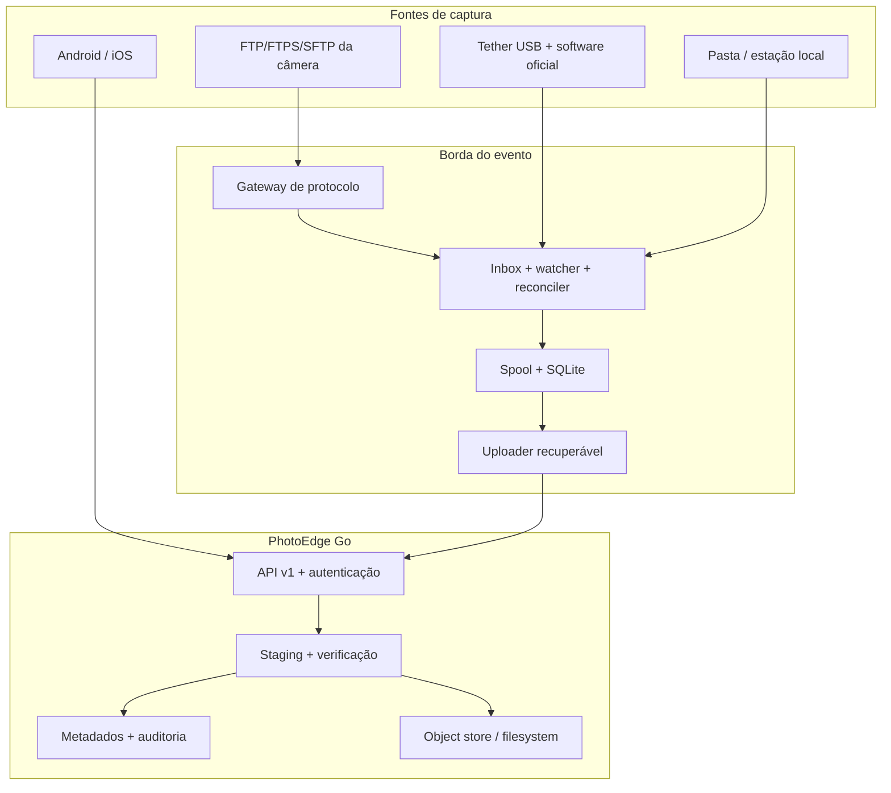
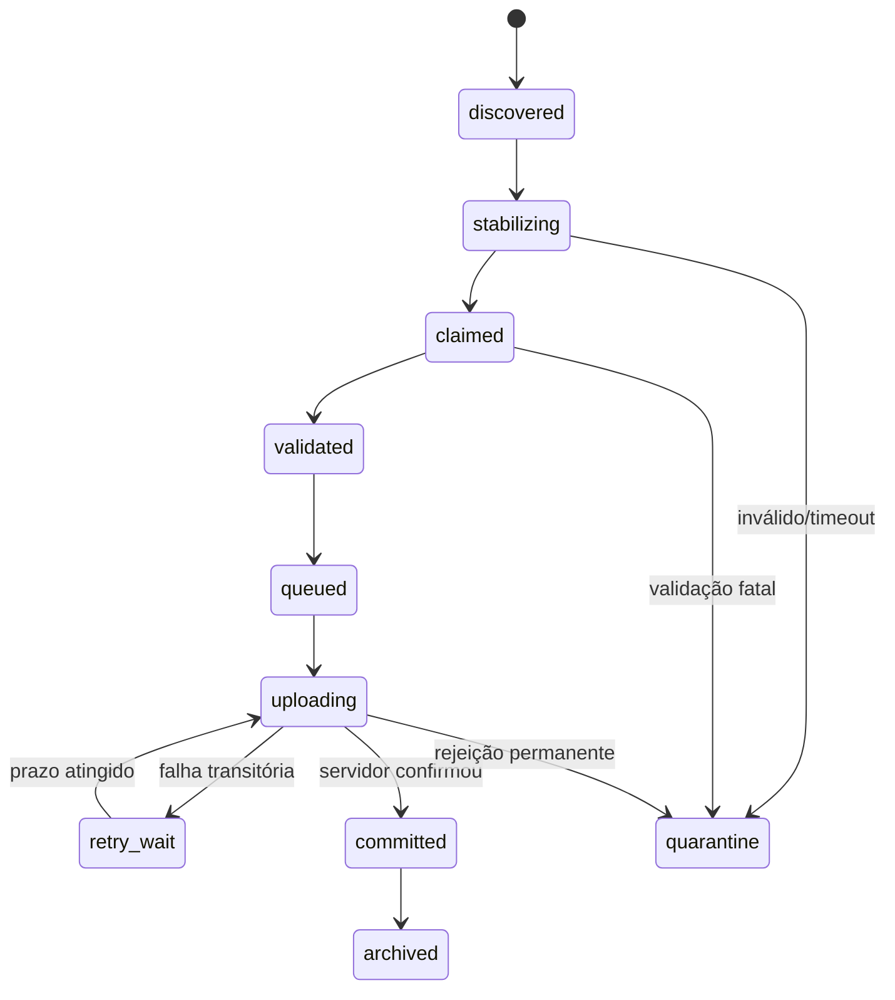
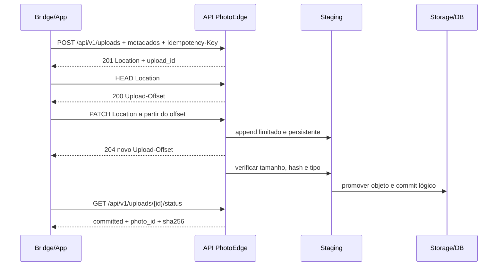
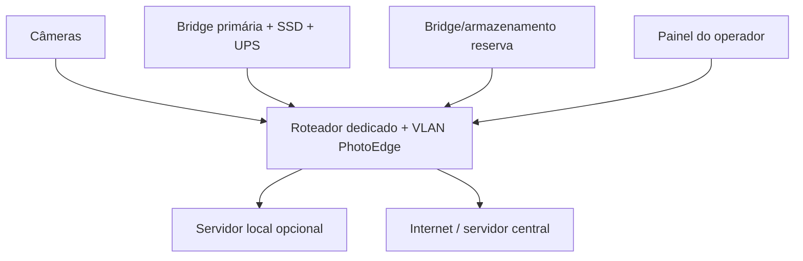

# PhotoEdge: arquitetura de ingestão fotográfica automática e confiável

## Resumo executivo

A arquitetura correta é, de fato:



O servidor central **não deve conhecer modelos de câmera**. Ele deve conhecer dispositivos autenticados, eventos, sessões de upload, bytes, hashes e estados. Canon, Nikon, Sony, Fujifilm, Panasonic, Android, iOS e software de tethering são responsabilidades de adaptadores na borda.

Recomendações centrais:

1. Criar `cmd/photoedge-bridge` no mesmo repositório Go, mas como processo, configuração, banco SQLite e ciclo de release independentes do servidor.
2. Não escrever um servidor FTP/FTPS/SFTP do zero no primeiro release. Usar um gateway de protocolo endurecido — por exemplo, SFTPGo ou um serviço administrado pelo sistema, sujeito a avaliação de licença e segurança — para terminar o protocolo da câmera e gravar em uma inbox local. A Bridge consome essa inbox. SFTPGo suporta SFTP, FTP/S e HTTP/S e possui eventos/hooks que podem sinalizar a conclusão da transferência.[^19]
3. Entregar semântica **at-least-once com efeito idempotente**. A Bridge pode reenviar; o servidor deve produzir uma única foto lógica para a mesma operação. “Exactly once” não será prometido como propriedade de transporte.
4. Persistir a fila da Bridge em SQLite local, em disco local, com WAL, `synchronous=FULL`, `busy_timeout`, um escritor lógico e reconciliação após reinício. WAL melhora a concorrência entre leitores e escritor, mas continua tendo um único escritor e não deve ficar em filesystem de rede.[^8][^10]
5. Implementar upload recuperável. O plano de dados recomendado segue o Tus 1.0: `POST` cria o recurso, `HEAD` consulta offset e `PATCH` continua a partir dele; offset incorreto retorna `409`.[^3] O controle de domínio PhotoEdge adiciona autenticação, evento, `photo_id`, hash e status.
6. Usar três identidades diferentes: `client_photo_id` identifica a captura no cliente; `Idempotency-Key` identifica uma tentativa lógica de criar a sessão; `sha256` identifica o conteúdo. Elas resolvem problemas diferentes e não são intercambiáveis.
7. Manter JPEG e RAW como objetos independentes, relacionados por um `capture_group_id`. Em evento, priorizar JPEG para latência e drenar RAW em uma fila de menor prioridade.
8. Considerar o cartão da câmera como primeira cópia, o spool da Bridge como segunda e o armazenamento confirmado pelo servidor como terceira. Nunca apagar automaticamente o original antes do encerramento e da reconciliação do evento.
9. Em Android, a automação pode observar MediaStore com permissão apropriada e usar foreground service durante “modo evento”; WorkManager é a rede de segurança persistente. Em iOS, uploads já criados podem continuar via background `URLSession`, mas a descoberta contínua da galeria não é garantida quando o app está suspenso. O caminho de maior confiabilidade é captura/importação dentro do app, share extension ou integração explícita com o app da câmera.[^35][^37][^39]
10. Certificar **modelo + firmware + acessório + modo de rede**, não apenas marca ou família. “Sony A7”, “Nikon Z6” ou “Fujifilm X” são nomes insuficientes para prometer compatibilidade.

### Recomendação executiva para o MVP

O primeiro MVP físico deve usar **Canon EOS R5 e EOS R6**, com duas rotas exercitadas sobre os mesmos corpos:

- rota primária: auto transfer por FTPS para gateway externo;
- rota de contingência: EOS Utility/tethering para pasta monitorada;
- Bridge compilada para Windows e Linux;
- appliance de evento preferencial em Linux, executado como serviço sem privilégio;
- estação Windows suportada para os softwares oficiais de tethering.

O gateway indicado para o piloto é SFTPGo em processo separado, condicionado à revisão da licença AGPLv3 da edição Community ou contratação da edição Enterprise. Se a revisão não autorizar essa distribuição/operação, usar IIS FTP/FTPS no Windows ou um daemon tradicional no Linux sem alterar a Bridge. Embutir FTP/SFTP no binário PhotoEdge fica explicitamente fora do MVP.

Classificação usada no relatório:

- **Comprovado:** afirmação diretamente sustentada por manual, RFC ou documentação oficial citada;
- **Inferência:** decisão técnica derivada das evidências e das propriedades desejadas;
- **Teste de campo:** comportamento que precisa ser medido na combinação exata de hardware, firmware, gateway e rede.

## 1. Escopo, objetivos e garantias

### 1.1 Objetivos de serviço sugeridos

Os números abaixo são alvos iniciais, a confirmar em teste de campo:

| Propriedade | Meta de produção |
|---|---:|
| Perda de arquivo já aceito pela Bridge | 0 em falhas simples de processo/rede |
| Duplicata lógica causada por retry | 0 |
| Latência JPEG em LAN, p95 | até 5 s após o arquivo ficar completo |
| Recuperação após retorno da rede | automática, sem intervenção |
| Memória por upload | limitada por buffer; nunca proporcional ao RAW inteiro |
| Rastreabilidade | captura → ocorrência → tentativas → sessão → objeto |
| Operação offline | limitada por capacidade de spool, não por tempo arbitrário |

“Aceito pela Bridge” significa: o arquivo foi reivindicado para o spool, validado minimamente e o registro da fila foi commitado. “Confirmado pelo servidor” significa: bytes recebidos, comprimento e SHA-256 verificados, arquivo promovido ao armazenamento durável e registro lógico commitado.

### 1.2 Modelo de entrega

O protocolo HTTP define como idempotente a operação cujo efeito pretendido de repetições idênticas é o mesmo de uma única execução.[^1] O transporte real, porém, pode falhar depois de o servidor processar a solicitação e antes de o cliente receber a resposta. A solução é:

- a Bridge mantém entrega **at-least-once**;
- a API torna criação e finalização idempotentes;
- o servidor deduplica conteúdo quando a política do evento permitir;
- todas as ocorrências continuam registradas para auditoria.

Não se deve afirmar “exactly once upload”. A propriedade útil é “zero perda após aceite local e efeito único observável no servidor”.

### 1.3 Não objetivos do primeiro release

- controlar obturador, foco ou exposição de cada câmera;
- implementar SDK proprietário de cada fabricante;
- substituir o software de tethering em estúdio;
- transcodificar todos os RAWs na Bridge;
- prometer ingestão invisível de toda a galeria do iOS em tempo real;
- expor o servidor central diretamente a FTP da internet.

## 2. Arquitetura de referência



### 2.1 Limites de responsabilidade

| Componente | Responsável por | Não responsável por |
|---|---|---|
| Gateway FTP/FTPS/SFTP | protocolo, TLS/SSH, usuário da câmera, pasta por dispositivo, evento de transferência completa | hash de negócio, retry HTTP, deduplicação global |
| PhotoEdge Bridge | descoberta, estabilidade, claim atômico, validação, EXIF, fila, retry, upload, painel local | regras particulares do armazenamento central |
| App mobile | importação/captura, permissão, fila offline, background permitido pela plataforma | prometer execução permanente fora das regras do SO |
| PhotoEdge Server | identidade/autorização, sessão, idempotência, verificação, persistência, auditoria | falar diretamente com câmeras |
| Storage | durabilidade dos bytes e retenção | semântica de evento ou dispositivo |

### 2.2 Gateway separado do núcleo

FTP é difícil de operar com segurança por causa de canais de controle/dados e faixas de portas passivas. Câmeras também variam em TLS, certificados, SFTP e comportamento de reconexão. A recomendação é:

- gateway em processo/container separado;
- uma credencial e diretório raiz por câmera/dispositivo;
- bind apenas na VLAN do evento;
- FTPS ou SFTP quando o corpo suportar; FTP simples somente como exceção em rede isolada;
- hook de “upload concluído” grava um pequeno marcador ou chama uma API local autenticada da Bridge;
- a Bridge também faz varredura periódica, pois hook e watcher podem falhar;
- revisão jurídica antes de incorporar ou distribuir software AGPL; executar um binário separado não elimina automaticamente obrigações de licença.

Isso reduz a superfície privilegiada do binário principal e permite trocar o gateway sem alterar o contrato PhotoEdge.

### 2.3 Matriz de decisão dos gateways

| Opção | Protocolos / SO | Segurança e isolamento | Eventos, logs e métricas | Licença | Prós | Contras | Decisão |
|---|---|---|---|---|---|---|---|
| SFTPGo Community | SFTP, FTP/FTPS, HTTP/S e WebDAV; Linux, Windows, macOS, FreeBSD | usuário, home/virtual folders, quotas e permissões lógicas; deve rodar sem privilégio | Event Manager chama HTTP após evento; logs JSON; `/metrics` Prometheus | AGPL-3.0-only com termos adicionais | um gateway multimarca e multiplataforma; API/admin; hook de upload | revisão jurídica obrigatória; isolamento é do processo, não uma identidade de SO por sessão | **Piloto recomendado**, se licença aprovada[^42][^43] |
| SFTPGo Enterprise | mesmos protocolos e plataformas | mesmos controles, com recursos/suporte comerciais adicionais | suporte profissional e automações ampliadas | comercial, sem copyleft | reduz risco de licença/suporte; upgrade direto | custo e dependência comercial | **Alternativa de produção** quando SLA justificar[^42] |
| IIS FTP | FTP/FTPS; Windows Server/Windows | FTP User Isolation + ACL NTFS; TLS e autenticação configuráveis | logs/ETW; sem evento HTTP de conclusão equivalente no núcleo | componente Microsoft/Windows | natural em ambiente Windows; isolamento e passive range documentados | não oferece SFTP; operação de certificado/firewall; integração depende de watcher/reconciler | **Fallback Windows**[^44] |
| OpenSSH `internal-sftp` | SFTP; Unix/Linux e Windows moderno | SSH, chave/senha, `ChrootDirectory`, `ForceCommand`, ACL do SO | syslog/arquivo; sem webhook de transferência completo nativo | BSD-style | superfície menor; uma porta; licença permissiva | só atende câmeras com SFTP; chroot/ACL no Windows têm restrições; hook exige integração externa | **Boa opção SFTP-only**[^45] |
| ProFTPD/daemon Unix tradicional | FTP; FTPS/SFTP por módulos/configuração; Unix-like | chroot, usuários virtuais, PAM/LDAP/SQL, controles de diretório | logging extensível; hooks/módulos exigem configuração | GPL-2.0 | maduro e altamente configurável | não é solução Windows; build/módulos e hardening elevam custo operacional | **Opção Linux especializada**[^46] |
| Embutido em Go | `ftpserverlib` para FTP/FTPS; `pkg/sftp` + SSH para SFTP; potencialmente multiplataforma | tudo — auth, sandbox, TLS/SSH, quotas e atualização — vira responsabilidade PhotoEdge | é necessário construir hooks, auditoria, métricas, admin e recovery | MIT + BSD-2-Clause nas bibliotecas citadas | uma distribuição e integração direta | amplia superfície, testes de protocolo e responsabilidade de segurança; não entrega um MFT pronto | **Não usar no MVP**[^47][^48] |

#### Evidência e inferência

**Comprovado:** SFTPGo Community declara AGPLv3, suporta os quatro protocolos, instala em Windows/Linux, possui Event Manager com notificação HTTP, logs JSON e endpoint Prometheus.[^42][^43] A documentação também alerta que o processo não troca para uma identidade de SO por sessão e recomenda conta sem privilégio; no Windows, o instalador registra inicialmente `LocalSystem`, devendo-se reconfigurar uma conta dedicada após upgrades.[^42]

**Inferência:** SFTPGo é o melhor fit funcional porque reduz diferenças entre câmeras sem levar protocolos para o núcleo. Isso não torna sua licença automaticamente adequada ao PhotoEdge. A aprovação deve vir de revisão jurídica do modo de uso, distribuição, modificações e interação em rede; executar como sidecar não é uma conclusão jurídica suficiente.

**Teste de campo:** confirmar que o evento `upload` somente dispara depois do fechamento bem-sucedido do arquivo para FTP, FTPS e SFTP; confirmar nomes, overwrite, restart/resume e `FsPath` em Windows e Linux. Mesmo com hook, manter reconciler periódico.

#### Perfil mínimo do gateway escolhido

- bind somente na interface/VLAN de câmeras;
- uma conta e home por câmera, sem anonymous login;
- senha aleatória exclusiva para FTP/FTPS; chave exclusiva quando SFTP for viável;
- upload e listagem estritamente necessários; negar rename/delete/chmod/chown quando a câmera não precisar;
- passive port range pequeno, fixo e aberto apenas na VLAN;
- arquivo local em volume compartilhado somente com a Bridge, nunca webroot;
- processo sem privilégio e diretórios sem execução;
- hook HTTP para `127.0.0.1` com segredo próprio, payload mínimo e timeout curto;
- logs do gateway em pipeline separado, com remoção de caminho/nome quando exportados;
- upgrade congelado durante evento e homologado antes.

## 3. Implementação da PhotoEdge Bridge

### 3.1 Estrutura de repositório

```text
cmd/
  photoedge/                 # servidor central
  photoedge-bridge/          # daemon/serviço da borda
  photoedge-admin/           # opcional: provisionamento e diagnóstico
internal/
  contracts/                 # tipos estáveis, validação e versão de protocolo
  bridge/
    app/                     # orquestração e máquina de estados
    adapters/
      folder/
      ftphook/
      tether/
    claim/                   # estabilidade e claim atômico
    metadata/                # EXIF e normalização
    queue/                   # SQLite e leases
    uploader/                # HTTP/Tus, retry e status
    dashboard/               # UI local somente leitura/ações controladas
  server/
    api/
    auth/
    uploads/
    storage/
    audit/
    observability/
api/openapi/
migrations/bridge/
migrations/server/
deploy/bridge/
deploy/server/
test/contract/
test/fixtures/
test/chaos/
```

Mesmo repositório é uma boa decisão para compartilhar contrato, testes e observabilidade. Os binários, entretanto, não devem compartilhar banco, diretório de dados, configuração nem ciclo de vida. `internal/contracts` deve conter somente tipos/protocolo; importar repositórios concretos do servidor na Bridge criaria acoplamento indevido.

Interfaces de domínio mínimas:

```go
type Candidate struct {
	SourceID, EventID, Path string
	ObservedAt              time.Time
	CompletionEvidence      string // hook, atomic_rename, stable_probe
}

type SourceAdapter interface {
	Run(ctx context.Context, out chan<- Candidate) error
	Reconcile(ctx context.Context, out chan<- Candidate) error
}

type Claimer interface {
	Claim(ctx context.Context, c Candidate) (ClaimedFile, error)
}

type Queue interface {
	Enqueue(ctx context.Context, item Item) error
	LeaseNext(ctx context.Context, worker string, ttl time.Duration) (*Item, error)
	Transition(ctx context.Context, id string, from, to State, patch Patch) error
}

type UploadClient interface {
	CreateOrRecover(ctx context.Context, item Item) (Session, error)
	Resume(ctx context.Context, session Session, file io.ReaderAt) (Result, error)
}
```

Regras de dependência: adaptadores dependem dessas portas; `app` compõe adaptadores; SQLite e HTTP são implementações; nenhuma lógica de estado fica no handler do filesystem ou no cliente HTTP. Todos os erros cruzam fronteiras como códigos tipados (`ErrStillWriting`, `ErrPermanentValidation`, `ErrRetryableRemote`), e texto livre é redigido antes de persistir/logar.

Configuração inicial:

```yaml
bridge:
  id: br_evento_a_01
  data_dir: /var/lib/photoedge-bridge
  reconcile_interval: 30s
  lease_ttl: 2m
  min_free_bytes: 53687091200
sources:
  - id: canon_r5_01
    type: folder
    event_id: evt_2026_001
    inbox: /srv/camera-inbox/canon_r5_01
    stable_for: 2s
upload:
  base_url: https://ingest.photoedge.example
  max_parallel_jpeg: 4
  max_parallel_raw: 2
  retry_cap_online: 60s
  retry_cap_offline: 5m
metadata:
  exiftool_path: /usr/bin/exiftool
  timeout: 10s
```

Segredos não entram no YAML. O arquivo aponta para keystore/secret store do sistema; `photoedge-bridge doctor` verifica permissões, DB, espaço, DNS, TLS, API capabilities e cada inbox sem imprimir credenciais.

### 3.2 Pipeline de arquivos

1. **Discover** — watcher recebe evento e reconciler encontra arquivos esquecidos.
2. **Stabilize** — aguarda evidência de que a escrita terminou.
3. **Claim** — move atomicamente para diretório controlado pela Bridge no mesmo volume.
4. **Validate** — confirma arquivo regular, limites, assinatura, comprimento e legibilidade mínima.
5. **Fingerprint** — calcula SHA-256 por streaming.
6. **Metadata** — extrai subconjunto de EXIF/IPTC/XMP com timeout.
7. **Enqueue** — transação SQLite torna o item durável.
8. **Upload** — inicia/retoma sessão.
9. **Verify** — servidor compara comprimento/hash e persiste.
10. **Archive** — Bridge retém ou move o spool conforme política; nunca antes da confirmação.

### 3.3 Watcher confiável

Bibliotecas como `fsnotify` abstraem inotify, kqueue, FEN e ReadDirectoryChangesW. A própria documentação recomenda observar o diretório pai, pois aplicações frequentemente substituem arquivos por rename atômico; notificações podem também ser perdidas/estourar.[^11]

Portanto, watcher é um acelerador, não a fonte de verdade:

- observar diretórios, não arquivos individuais;
- debouncer apenas reduz ruído; não decide conclusão;
- reconciler faz `WalkDir` na inicialização e a cada 30–60 s;
- persistir `source_fingerprint` para não reimportar após restart;
- limitar profundidade e impedir travessia por symlink;
- lidar com rename, create e write; não depender de um único evento `CLOSE_WRITE`, ausente em várias plataformas.

### 3.4 Como saber que o arquivo terminou de ser gravado

Ordem de confiança:

1. **evento de conclusão do produtor/gateway**;
2. **arquivo temporário + rename atômico no mesmo filesystem**;
3. **claim atômico bem-sucedido após quiescência**;
4. **tamanho e `mtime` estáveis em múltiplas sondagens + parser válido**.

Configuração inicial sugerida:

- JPEG/HEIC: duas amostras iguais separadas por 1 s;
- RAW: três amostras iguais separadas por 2 s;
- timeout de estabilização: 5 min;
- arquivo ainda crescendo volta ao estado `stabilizing` sem consumir tentativa HTTP;
- zero bytes, alteração após claim ou parser truncado vão para quarentena.

A estabilidade de tamanho não é prova absoluta: uma transferência pode pausar. Quando não houver hook de conclusão, exigir também idade mínima, abertura bem-sucedida e validação estrutural. O claim ideal é `rename(inbox, spool/claimed)` no mesmo volume; rename entre volumes pode virar cópia não atômica.

### 3.5 Spool e layout de disco

```text
data/
  inbox/<source-id>/
  spool/claimed/YYYY/MM/DD/
  spool/archive/YYYY/MM/DD/
  quarantine/<reason>/
  db/bridge.sqlite3
  logs/
```

Regras:

- spool e inbox preferencialmente no mesmo filesystem para claim atômico;
- arquivo recebe nome interno aleatório; nome original fica como metadado não confiável;
- permissões do serviço sem execução e sem acesso desnecessário;
- o painel nunca constrói caminho a partir do nome enviado pelo cliente;
- retenção do archive por tempo e capacidade, mas só remove itens `committed` e segundo uma política explícita;
- reserva de disco separada para o banco e logs, evitando que o spool consuma 100%.

### 3.6 SQLite local e esquema

SQLite é adequado para storage local de dispositivo e baixa concorrência de escrita; seu commit atômico usa journal/WAL e barreiras de sincronização, mas a durabilidade depende do filesystem e da configuração.[^9][^10]

Configuração:

```sql
PRAGMA journal_mode = WAL;
PRAGMA synchronous = FULL;
PRAGMA foreign_keys = ON;
PRAGMA busy_timeout = 5000;
PRAGMA wal_autocheckpoint = 1000;
```

Um único goroutine/repositório executa mutações; workers leem e pedem transições. Não guardar bytes da foto como BLOB.

Esquema de referência, a ajustar às convenções do projeto:

```sql
CREATE TABLE queue_items (
  local_id              TEXT PRIMARY KEY,
  source_id             TEXT NOT NULL,
  event_id              TEXT NOT NULL,
  client_photo_id       TEXT NOT NULL,
  capture_group_id      TEXT,
  original_filename     TEXT NOT NULL,
  claimed_path          TEXT NOT NULL,
  source_fingerprint    TEXT NOT NULL,
  media_type            TEXT,
  size_bytes            INTEGER NOT NULL CHECK (size_bytes >= 0),
  sha256_hex             TEXT NOT NULL CHECK (length(sha256_hex) = 64),
  captured_at            TEXT,
  captured_at_source     TEXT NOT NULL DEFAULT 'unknown',
  state                  TEXT NOT NULL,
  priority               INTEGER NOT NULL DEFAULT 100,
  attempt_count          INTEGER NOT NULL DEFAULT 0,
  next_attempt_at        TEXT,
  lease_owner            TEXT,
  lease_until            TEXT,
  upload_id              TEXT,
  server_photo_id        TEXT,
  last_error_code        TEXT,
  last_error_redacted    TEXT,
  created_at             TEXT NOT NULL,
  updated_at             TEXT NOT NULL,
  committed_at           TEXT,
  UNIQUE(source_id, source_fingerprint),
  UNIQUE(event_id, client_photo_id)
);

CREATE INDEX queue_ready_idx
  ON queue_items(state, next_attempt_at, priority, created_at);

CREATE TABLE upload_attempts (
  attempt_id             TEXT PRIMARY KEY,
  local_id               TEXT NOT NULL REFERENCES queue_items(local_id),
  started_at             TEXT NOT NULL,
  finished_at            TEXT,
  request_id             TEXT,
  bytes_sent             INTEGER NOT NULL DEFAULT 0,
  http_status            INTEGER,
  outcome_code           TEXT,
  error_redacted         TEXT
);
```

`source_fingerprint` pode ser, antes do hash existir, uma composição versionada de origem, caminho normalizado, file-id/inode quando confiável, tamanho e tempo; depois o SHA é a identidade de conteúdo. Não usar somente nome do arquivo: contadores de câmera reiniciam e nomes se repetem.

### 3.7 Máquina de estados e leases



Claim de worker:

- iniciar transação imediata;
- escolher item `queued/retry_wait` vencido e com lease ausente/expirado;
- definir `lease_owner`, `lease_until` e `uploading`;
- commit;
- renovar lease durante upload longo;
- ao restart, itens com lease expirado voltam a ser elegíveis;
- o contrato idempotente torna seguro retomar mesmo sem saber se o servidor processou a última chamada.

### 3.8 Retry e backoff

Retry deve combinar erro retryable e operação idempotente. Backoff exponencial com jitter evita sincronização de múltiplos clientes, princípio recomendado também por provedores de storage.[^7]

Algoritmo de **full jitter**:

```text
delay = random(0, min(cap, base * 2^attempt))
```

Valores iniciais:

- `base=1s`, `cap=60s` quando online no evento;
- após 10 min offline, `cap=5min`;
- honrar `Retry-After` quando maior;
- resetar contador depois de progresso confirmado;
- concorrência inicial: 2 RAW ou 4 JPEG por Bridge, ajustada por medição.

| Situação | Ação do cliente |
|---|---|
| timeout, reset, DNS, 408 | consultar status/offset e repetir com backoff |
| 401 | renovar token uma vez; depois bloquear como auth |
| 403 | permanente até reprovisionamento/autorização |
| 409 offset | `HEAD`, alinhar ao offset do servidor e continuar |
| 409 idempotency in progress | aguardar `Retry-After` e consultar sessão |
| 413, 415, 422 | quarentena/erro permanente, sem loop |
| 429 | `Retry-After` + jitter; reduzir concorrência |
| 500, 502, 503, 504 | retry com status/offset antes de retransmitir |
| 507 | pausar e alertar operador; reter localmente |

O RFC 6585 define `429 Too Many Requests` e permite `Retry-After`.[^6]

### 3.9 Hash e metadados

- SHA-256 calculado por streaming depois do claim;
- comparar tamanho antes e depois; alteração implica corrupção/violação do contrato;
- enviar digest do chunk com `Content-Digest` quando suportado; RFC 9530 padroniza os campos de digest e diferencia conteúdo da mensagem/representação.[^4]
- servidor sempre recalcula o SHA final; nunca confia no cliente;
- EXIF é não confiável e não participa de autorização;
- `captured_at` com timezone conhecido usa RFC 3339; EXIF sem offset fica com valor local bruto e `captured_at_source/confidence`, em vez de fingir UTC;
- GPS e identificadores de câmera são dados sensíveis e só devem ser persistidos se necessários.

ExifTool cobre EXIF, GPS, IPTC, XMP e muitos formatos RAW.[^12] Para máxima compatibilidade no desktop, uma primeira implementação pode usar processo ExifTool persistente (`-stay_open`) com timeout, limite de saída, usuário sem privilégio e argumentos fixos. Não passar nome de arquivo como opção. Uma implementação Go nativa pode extrair o subconjunto comum, mantendo ExifTool como fallback.

### 3.10 Painel local

Disponível apenas em loopback ou LAN administrativa autenticada:

- estado do gateway e de cada fonte;
- fotos/bytes por estado;
- idade do item mais antigo;
- throughput atual e médio;
- disco livre e tempo estimado até esgotar;
- último sucesso/erro por câmera, com mensagem redigida;
- botões controlados: pausar, retomar, retry agora, exportar diagnóstico sanitizado;
- jamais exibir token, senha FTP, EXIF GPS ou caminho absoluto por padrão.

## 4. Contrato cliente-servidor

### 4.1 Identidades

| Campo | Origem | Semântica |
|---|---|---|
| `device_id` | provisionamento do servidor | identidade autenticada da Bridge/app; corpo deve coincidir com token |
| `event_id` | atribuição operacional | tenant/escopo de autorização e retenção |
| `client_photo_id` | cliente, UUIDv7/UUIDv4 | captura lógica estável através de retries |
| `photo_id` | servidor | registro canônico retornado |
| `capture_group_id` | cliente | relaciona RAW/JPEG/HEIF do mesmo disparo |
| `upload_id` | servidor | sessão de transporte recuperável |
| `Idempotency-Key` | cliente | uma operação lógica de criação/finalização |
| `sha256` | ambos verificam | identidade dos bytes completos |

O draft de `Idempotency-Key` é uma referência de desenho — **não um RFC vigente** e expirou em abril de 2026. Ele descreve unicidade, fingerprint, expiração e conflitos; PhotoEdge deve documentar sua própria semântica estável.[^2]

Escopo de armazenamento da chave:

```text
(device_id, method, route_template, idempotency_key)
```

Fingerprint do request:

```text
SHA-256(canonical-json(event_id, client_photo_id, sha256, size_bytes))
```

- mesma chave + mesmo fingerprint: devolver a mesma sessão/resposta;
- mesma chave + fingerprint diferente: `422 idempotency_key_reused`;
- requisição concorrente ainda não materializada: `409 idempotency_in_progress`;
- retenção da chave: no mínimo retenção máxima de spool + margem; sugestão 30 dias, configurável e documentada.

### 4.2 Plano de dados recuperável

#### Decisão: simples, Tus ou draft IETF

| Alternativa | Vantagens | Limitações | Uso PhotoEdge |
|---|---|---|---|
| `PUT`/multipart idempotente de arquivo inteiro | implementação e depuração simples; ótimo para primeiro teste ponta a ponta | falha no fim retransmite tudo; caro para RAW e rede móvel; restart perde progresso | fallback para JPEG pequeno e ambiente local, não protocolo único de produção |
| Tus 1.0 | protocolo publicado, bibliotecas existentes, criação/offset/append/checksum/expiration | precisa integrar autenticação, metadata e commit PhotoEdge; compatibilidade deve ser testada | **recomendado para produção**[^3] |
| IETF resumable-upload draft-12 | candidato a padrão HTTP, upload resource e fallback para upload convencional | ainda é Internet-Draft, pode mudar e não deve ser tratado como RFC | monitorar; não acoplar v1 a ele até maturidade de RFC/ecossistema[^49] |

Adotar Tus 1.0 no endpoint de bytes evita inventar regras de offset. O upload simples pode permanecer como capability opcional para arquivos abaixo de um limite configurável, desde que use o mesmo `client_photo_id`, hash, autorização e commit. Fluxo resumível:



Criação:

```http
POST /api/v1/uploads HTTP/1.1
Authorization: Bearer <token>
Idempotency-Key: 018f4f3c-...
Tus-Resumable: 1.0.0
Upload-Length: 48372918
Upload-Metadata: event_id ZXZ0XzEyMw==,client_photo_id MDE4Zi4uLg==,filename SU1HXzAwMDEuQ1Iz,sha256 YWJjLi4u
X-PhotoEdge-Client: bridge/1.3.0
```

O servidor extrai `device_id` do token. Se `device_id` também vier como metadata, divergência é `403`. Nomes são apenas apresentação e devem ser sanitizados.

Resposta inicial:

```http
HTTP/1.1 201 Created
Location: /api/v1/uploads/upl_01J...
Tus-Resumable: 1.0.0
PhotoEdge-Upload-Id: upl_01J...
PhotoEdge-Photo-Id: pho_01J...
```

O `PATCH` usa `Upload-Offset`, `Content-Type: application/offset+octet-stream` e `Tus-Resumable`. O servidor limita tamanho de chunk e quantidade de sessões abertas. `HEAD` é a fonte de verdade depois de qualquer resposta ambígua. Se o endpoint não cumprir todo o Tus Core/Extensions declarados, não deve se anunciar como compatível; nesse caso, prefixar e versionar um protocolo próprio.

### 4.3 Estado e consulta

```http
GET /api/v1/uploads/upl_01J.../status
Authorization: Bearer <token>
```

```json
{
  "upload_id": "upl_01J...",
  "photo_id": "pho_01J...",
  "state": "committed",
  "offset": 48372918,
  "size_bytes": 48372918,
  "sha256": "ab12...",
  "duplicate_of": null,
  "created_at": "2026-09-14T14:30:00Z",
  "committed_at": "2026-09-14T14:30:08Z"
}
```

Estados públicos: `created`, `uploading`, `verifying`, `committed`, `rejected`, `expired`. Estados internos de filesystem não vazam.

### 4.4 Erros HTTP

Respostas usam `application/problem+json`, padronizado pelo RFC 9457.[^5]

| Código | Uso PhotoEdge | Retry |
|---:|---|---|
| 200 | replay idempotente/status | não necessário |
| 201 | sessão criada | não |
| 204 | chunk aceito | continuar |
| 400 | metadata/header malformado | corrigir cliente |
| 401 | token ausente/expirado | renovar uma vez |
| 403 | device revogado/evento negado | não até reprovisionar |
| 404 | recurso inexistente ou ocultado | não; reconciliar |
| 409 | offset ou operação concorrente | consultar/aguardar |
| 410 | sessão expirada | criar nova com nova chave |
| 413 | arquivo/chunk excede limite | não |
| 415 | tipo não permitido | não |
| 422 | hash/metadata inválida ou chave reutilizada | não |
| 429 | rate limit | sim, `Retry-After` |
| 500/502/503/504 | falha transitória | sim |
| 507 | staging sem espaço | pausar e alertar |

Exemplo:

```json
{
  "type": "https://photoedge.example/problems/hash-mismatch",
  "title": "Uploaded content does not match declared digest",
  "status": 422,
  "instance": "urn:request:req_01J...",
  "code": "hash_mismatch",
  "request_id": "req_01J...",
  "retryable": false
}
```

`detail` não deve conter caminho, SQL, stack trace, token ou dados EXIF.

### 4.5 Versionamento e compatibilidade

- major no path: `/api/v1`;
- OpenAPI versionada e testes de contrato no repositório;
- mudanças aditivas em v1; clientes ignoram campos desconhecidos;
- breaking change cria v2, com janela de convivência;
- `/api/v1/capabilities` informa `min_client_version`, limites, extensões Tus, tipos e tamanho de chunk;
- servidor registra versão do cliente, mas não cria labels Prometheus por versão completa;
- Bridge recusa upgrade de protocolo incompatível de forma explícita, sem descartar fila;
- migrações da Bridge devem ser rollback-safe ou suportar uma versão anterior durante canary.

## 5. Persistência e deduplicação no servidor

### 5.1 Fluxo durável

1. criar sessão no banco e arquivo `staging/<upload_id>.part` com limite prealocado quando possível;
2. gravar chunks por streaming, atualizar offset durável em fronteiras confirmadas;
3. ao completar, `fsync` do arquivo;
4. recalcular SHA-256, validar comprimento, assinatura e política;
5. promover por rename atômico no mesmo filesystem para `objects/sha256/aa/bb/<hash>`;
6. `fsync` do diretório quando a plataforma exigir;
7. transação de banco cria/atualiza objeto, foto, ocorrência e auditoria;
8. só então responder `committed`.

Filesystem e banco não compartilham uma transação. Por isso, um reconciler no startup trata:

- `.part` sem sessão: quarentena/orphan com TTL;
- sessão `uploading` com arquivo: validar offset;
- objeto promovido e sessão `verifying`: terminar commit;
- registro `committed` sem objeto: incidente de integridade, readiness degradada.

### 5.2 Deduplicação correta

Separar:

- `media_objects`: um registro por conteúdo SHA-256 + tamanho;
- `photos`: a entidade no evento;
- `photo_occurrences`: cada chegada/origem/tentativa relevante;
- `upload_sessions`: transporte.

Chave física pode ser global, mas autorização nunca é derivada do conhecimento do hash. Uma foto de outro evento não deve ser enumerável. Política sugerida:

- mesma `event_id + client_photo_id`: mesma foto lógica;
- mesma `event_id + sha256` por outro caminho: nova ocorrência ligada à foto existente, salvo modo que permita duplicata lógica;
- mesmo SHA em eventos diferentes: objeto físico pode ser reutilizado internamente, porém fotos, ACLs, auditoria e retenção permanecem separadas;
- colisão impossível não é presumida: também comparar tamanho e, em operações forenses, validar bytes.

### 5.3 Quarentena

Motivos codificados: `zero_length`, `too_large`, `unsupported_type`, `signature_mismatch`, `truncated`, `hash_mismatch`, `path_violation`, `metadata_timeout`, `malware_suspected`.

- não servir conteúdo em quarentena;
- acesso apenas a operador autorizado;
- retenção curta configurável;
- excluir com trilha de auditoria;
- não tentar decodificação pesada dentro do processo HTTP;
- scanners/parsers rodam com CPU, memória, tempo e permissões limitados.

OWASP recomenda allowlist de extensões, não confiar em `Content-Type`, verificar assinatura, gerar nome no servidor, limitar tamanho, autorizar o uploader e armazenar fora do webroot.[^13]

## 6. Comunicação com câmeras profissionais

### 6.1 Modos de rede

| Modo | Vantagem | Limitação | Uso recomendado |
|---|---|---|---|
| camera access point | configuração rápida, sem roteador | normalmente topologia 1:1, bridge perde outra rede, alcance/gestão limitados | kit pequeno, fallback de campo |
| infrastructure/station | múltiplas câmeras, bridge e painel na mesma LAN, DHCP/reservas, VLAN | depende de roteador bem configurado | padrão de evento |
| Ethernet | latência/throughput previsíveis, menos interferência | cabo/acessório/porta e consumo | estúdio, esporte, estação fixa |
| USB tethering | captura e controle por software oficial | notebook por câmera/porta, cabo e drivers | estúdio e modelos sem FTP robusto |

A Nikon Z8 documenta tanto access point direto quanto station mode por roteador e observa que station pode alcançar FTP em outras redes.[^24] Para evento multi-fotógrafo, infrastructure mode é o padrão; SSID e VLAN exclusivos, 5/6 GHz quando suportado, DHCP reservations e sem client isolation entre câmeras e gateway.

### 6.2 FTP, FTPS e SFTP não são equivalentes

- FTP: credenciais e dados sem proteção; só aceitar como exceção numa VLAN isolada.
- FTPS/FTPES: FTP com TLS, certificado raiz e ainda canais/portas passivas.
- SFTP: protocolo sobre SSH, normalmente uma porta, não é “FTP com TLS”.

Não habilitar downgrade silencioso. O perfil do dispositivo declara protocolo e política. Se uma câmera não confia no certificado FTPS, o operador recebe erro de provisionamento; não se marca automaticamente “aceitar qualquer certificado”. Manuais Canon, Nikon e Sony mostram diferenças reais em root certificates, modos passivos e disponibilidade por interface.[^20][^22][^24][^29]

### 6.3 Tethering e pasta monitorada

O caminho mais compatível é usar software oficial para descarregar em pasta dedicada:

- Canon EOS Utility pode transferir imagens capturadas para o computador durante a conexão.[^41]
- Nikon NX Tether baixa imagens para o computador; Wireless Transmitter Utility configura perfis e lista combinações de corpos/transmissores.[^26][^27]
- Sony Imaging Edge Desktop Remote permite tethering e escolha do destino.[^30]
- Fujifilm X Acquire suporta tethering e auto-download para pasta em corpos compatíveis.[^33]
- LUMIX Tether publica matriz por modelo e interface.[^34]

Uma pasta exclusiva por câmera elimina ambiguidade. O software oficial escreve nela; a Bridge faz claim para seu spool. Atualizações do software/driver são congeladas durante a temporada e testadas antes do evento.

### 6.4 RAW + JPEG

Política recomendada:

- JPEG/HEIF: prioridade 10, objetivo de disponibilidade rápida;
- RAW: prioridade 100, preservação e edição;
- ambos compartilham `capture_group_id` quando o pareamento for confiável;
- não depender só de basename: combinar serial do corpo, sequência, timestamp com tolerância e, se disponível, identificador do fabricante;
- se pareamento for incerto, manter objetos separados e relacionar depois;
- nenhuma conversão destrutiva na Bridge.

Algumas câmeras permitem selecionar qual membro de RAW+JPEG é enviado. Canon documenta seleção RAW+JPEG/HEIF no fluxo FTP; Sony documenta JPEG/HEIF/RAW e retomada após reconexão em corpos como α7 IV.[^20][^29]

### 6.5 Velocidade, buffer, bateria e reconexão

- buffer da câmera é para captura, não uma fila de integração confiável;
- Wi‑Fi e transferência contínua aumentam consumo e podem impedir standby;
- “keep connection” pode elevar consumo; a Nikon Z8 explicita esse efeito.[^24]
- velocidade nominal do rádio não substitui benchmark com RAW real, distância, interferência e vários corpos;
- o cartão deve continuar gravando localmente;
- após queda, conferir contadores da câmera, inbox e servidor; não confiar apenas no ícone da câmera;
- manter baterias/adaptadores, cabos curtos presos e fonte/UPS para bridge/roteador.

## 7. Matriz de compatibilidade inicial

Legenda: **C** = comprovado em documentação oficial; **I** = inferência/recomendação; **T** = teste de campo obrigatório. A coluna “rota” não é uma certificação de interoperabilidade com PhotoEdge.

| Modelo exato | Rota documentada | Auto/recovery documentado | Dependências | Avaliação PhotoEdge | Classe |
|---|---|---|---|---|---|
| Canon EOS R5 | FTP/FTPS por Wi‑Fi; WFT‑R10 para rede adicional/cabeada; EOS Utility por tether | auto após disparo e retry quando a conexão retorna | certificado FTPS; WFT‑R10 para wired | **MVP primário:** testar FTPS direto e pasta EOS Utility | C+T[^20] |
| Canon EOS R6 original | FTP/FTPS por Wi‑Fi; EOS Utility | auto e retry documentados | sem alegar SFTP/Ethernet; power-save afeta sessão | **MVP primário:** segundo corpo, perfil Wi‑Fi independente | C+T[^21] |
| Canon EOS R6 Mark II | o rótulo “R6” não basta; perfil/manual próprio precisa ser congelado | não herdar conclusões da R6 original | firmware e body code | **Fora da certificação R6 original** até teste próprio | I+T |
| Canon EOS R3 | FTP/FTPS; SFTP no manual apenas quando wired; EOS Utility | auto, lote e retry | perfil separado wired/Wi‑Fi; Ethernet integrada | segunda onda, boa referência cabeada | C+T[^22] |
| Canon EOS R5 Mark II | FTP/FTPS/SFTP; EOS Utility | auto transfer configurável | Ethernet requer BG‑R20EP ou CF‑R20EP | segunda onda; validar SFTP e grip/cooling fan | C+T[^23] |
| Nikon Z8 | FTP/FTPS/SFTP por Wi‑Fi; Ethernet por adaptador USB‑C aprovado; NX Tether | auto/keep-connection; troubleshooting prevê caso de retomada por power-cycle | raiz FTPS, passive range e adaptador exato | forte candidato pós-Canon; teste de gateway é indispensável | C+T[^24] |
| Nikon Z9 | FTP/SFTP; FTPS adicionado por firmware; Wi‑Fi/Ethernet; NX Tether | auto upload documentado | registrar firmware; FTPS não existe em firmware antigo | segunda onda profissional | C+T[^25] |
| Nikon Z6/Z7 original | WT‑7 pode conectar a FTP; NX Tether/WTU para computador | não assumir mesma recovery de Z8/Z9 | WT‑7, geração e firmware | tether/pasta primeiro; FTP apenas após conjunto físico | C+I+T[^26][^27] |
| Nikon Z6 II/Z7 II | WT‑7 listado como compatível; NX Tether/WTU | validar comportamento no corpo | WT‑7 e firmware | perfil separado da geração original | C+T[^26][^27] |
| Sony α7 IV (ILCE‑7M4) | FTP/FTPES em modo passivo; Imaging Edge/tether | auto e transferência pendente após reconexão; recursos adicionais dependem do firmware 6.00 | raiz/ciphers FTPES e firmware | primeiro Sony recomendado depois do MVP Canon | C+T[^29] |
| Sony α7R V (ILCE‑7RM5) | FTP/FTPES; Imaging Edge/tether | auto e pending transfer após retorno; filtros adicionais no firmware 4.00 | firmware e perfil de servidor | segunda onda Sony; testar RAW grande | C+T[^50] |
| Sony α1 (ILCE‑1, Ver.2+) | FTP/FTPES/SFTP conforme guia; wired LAN, Wi‑Fi e tether | auto e reenvio quando conexão retorna | manual da versão 2+, protocolo/cipher exato | excelente corpo profissional, mas não necessário ao MVP | C+T[^51] |
| Sony α9 III (ILCE‑9M3) | FTP/FTPES/SFTP conforme perfil; Imaging Edge | auto, retorno automático e seleção RAW+JPEG/HEIF | firmware, power-save, transporte | segunda onda para esporte/rajada | C+T[^52] |
| Sony α9/α9 II | não herdar capacidades da α9 III; Transfer & Tagging lista combinações e requisitos | varia por geração/firmware | body code e firmware obrigatórios | perfis separados; sem promessa genérica “A9” | C+I+T[^28] |
| Fujifilm GFX100 II / GFX100S II | FTP/FTPS direto; X Acquire/tether | auto image transfer e queue | certificado, perfil e formato | candidato Fujifilm direto pós-Sony/Nikon | C+T[^31] |
| Fujifilm X‑H2/X‑H2S | FTP/FTPS e wired LAN com FT‑XH; USB/Wi‑Fi tether | perfis e fila documentados | FT‑XH para Ethernet e maior desempenho wireless | segunda onda; validar FT‑XH e bateria | C+T[^32][^54] |
| Fujifilm X‑T5 | USB/Wi‑Fi tether com X Acquire/plug-ins; Frame.io é destino próprio, não FTP PhotoEdge | download automático por tether; modo fixed pode parar gravação no cartão quando desconectado | configuração de tether e software no Windows/macOS | **folder watcher**, não FTP direto genérico | C+I+T[^53] |
| Demais Fujifilm GFX/X‑H/X‑T | capacidades variam; X Acquire não garante auto-download em todo corpo | desconhecido até manual exato | modelo/firmware/software | sem certificação por família | C+T[^33] |
| Panasonic GH7/GH5 II | LUMIX Tether por Ethernet ou USB | comportamento pertence ao software de tether | software/driver e modo do corpo | folder watcher; sem alegar FTP direto | C+I+T[^34] |
| Panasonic S5 II X/S1R II/S1 II | LUMIX Tether por Ethernet ou USB | validar download e reconexão | modelo e versão do Tether | folder watcher | C+I+T[^34] |
| Panasonic GH6/G9 II/S5/S1/S1R/S1H | LUMIX Tether por USB na matriz consultada | validar por modelo | cabo, driver, versão | folder watcher; menor prioridade | C+I+T[^34] |
| Panasonic BGH1/BS1H | LUMIX Tether por Ethernet/Wi‑Fi/USB | validar fotografia e destino local | corpos orientados a vídeo; software | somente se o caso de uso exigir | C+I+T[^34] |

### 7.1 Seleção do MVP

**Escolha:** Canon R5 + R6 original, SFTPGo/IIS como gateway intercambiável e EOS Utility como fallback de pasta.

**Inferência:** essa combinação testa os dois caminhos arquiteturais mais importantes — protocolo direto e tether/folder — sem multiplicar fabricantes antes de estabilizar fila, idempotência e operação. R5 e R6 têm auto transfer e retry documentados, mas usam perfis e limitações próprias; por isso contam como duas certificações.

**Critérios de passagem do MVP:** 500 arquivos mistos por corpo; três ciclos de queda Wi‑Fi; gateway/Bridge/server reiniciados em pontos aleatórios; SHA comparado com cartão; nenhuma perda; nenhuma foto lógica duplicada; retomada sem intervenção, exceto comportamento de câmera explicitamente documentado; relatório com firmware, protocolo, TLS, faixa passiva, bitrate e bateria.

### 7.2 Limitações da evidência de fabricante

- Suporte descrito no manual não equivale a interoperabilidade certificada com SFTPGo, IIS, OpenSSH ou PhotoEdge.
- Firmware é parte da identidade. Registrar `manufacturer`, `model`, `body_code`, `firmware`, `accessory`, `transport`, `gateway_version`, configuração e versão da suíte.
- Manuais frequentemente descrevem “FTP server” sem certificar software de terceiros, suites TLS, overwrite e semântica exata de retomada.
- A Sony diferencia funções até por versão de firmware; α7 IV usa firmware 6.00 para alguns filtros e α7R V usa 4.00 para funções adicionais.[^29][^50]
- A X‑T5 pode enviar automaticamente a Frame.io, mas isso não comprova FTP arbitrário para PhotoEdge; o caminho suportado aqui é tether → pasta.[^53]

## 8. Android e iOS

### 8.1 Modelo comum do app

O app implementa a mesma máquina de estados conceitual da Bridge:

```text
imported → fingerprinted → queued → uploading → retry_wait → committed
                         ↘ rejected/quarantine-local
```

- cópia controlada no sandbox antes de depender de URI temporária;
- banco local (Room/SQLite no Android; Core Data/SQLite no iOS);
- SHA-256 e EXIF em tarefa limitada;
- sessão HTTP recuperável compartilhando fixtures e testes de contrato com Go;
- política de Wi‑Fi/celular configurável;
- tela “modo evento” mostra fila, energia, rede e último sucesso.

### 8.2 Android

MediaStore indexa mídia compartilhada. Em versões recentes, fotos criadas pelo próprio app não exigem a mesma permissão de leitura; mídia de outros apps requer permissões específicas, e localização EXIF não redigida exige acesso adicional.[^35] Android 14 introduz acesso parcial a fotos selecionadas; uma URI permitida não deve ser confundida com acesso permanente a toda a galeria.[^36]

Rotas:

1. **Melhor confiabilidade:** câmera dentro do PhotoEdge app ou import explícito pelo Photo Picker; o app possui o arquivo.
2. **Evento Android gerenciado:** permissão de mídia justificada + `ContentObserver` + reconciliation por MediaStore; foreground service visível durante o evento.
3. **Pasta escolhida:** Storage Access Framework com permissão persistível, se o provedor realmente a oferece; watcher e varredura por documentos, não suposição de caminho real.
4. **Share intent:** apps oficiais de câmera compartilham para PhotoEdge.

WorkManager oferece constraints de rede, bateria e armazenamento e retry com backoff linear/exponencial; é indicado para trabalho persistente, não para promessa de latência subsegundo.[^37] Durante sessão ativa, usar foreground service de tipo/política aplicável e notificação. WorkManager reconcilia e drena depois que o processo é morto.

### 8.3 iOS

PhotoKit entrega mudanças ao observer enquanto o processo participa do ciclo de execução, mas iOS suspende apps em background e agenda tarefas de forma oportunística.[^38][^40]

Níveis de garantia:

| Rota | Garantia prática |
|---|---|
| captura dentro do PhotoEdge + arquivo no sandbox + background URLSession | mais forte; tarefa já criada pode continuar fora do processo |
| share extension/importação do app oficial da câmera | forte depois que o usuário compartilha/importa |
| app em foreground observando Photos | boa enquanto aberto |
| BGTask para reconciliar biblioteca | eventual, sem SLA de início |
| tentar observar Apple Camera continuamente com app suspenso | não suportar como promessa |

Sessões de background executam transferências fora do processo e podem continuar com o app suspenso, desde que a tarefa tenha sido criada corretamente e o payload seja baseado em arquivo.[^39] O sistema ainda decide agenda, energia e rede. O app deve copiar HEIC/JPEG/RAW para área própria, persistir o vínculo com `taskIdentifier`, implementar relançamento e reconciliar sessão PhotoEdge quando receber callback.

No fluxo Sony para telefone, a própria documentação exige que Transfer & Tagging permaneça em foreground em certos casos no iOS, evidência de que o sistema não deve prometer import FTP arbitrário em background.[^28]

### 8.4 Formatos mobile

- aceitar JPEG e HEIC/HEIF nativos sem conversão obrigatória;
- permitir DNG/RAW somente após validar limites e suporte do backend;
- registrar `media_type_detected`, não confiar em extensão;
- geração de thumbnail é job separado; falha de thumbnail não invalida original íntegro;
- preservar orientação/color profile; nunca regravar original para “corrigir” EXIF.

## 9. Operação do servidor

### 9.1 Liveness, readiness e startup

Kubernetes distingue readiness — retirar temporariamente o pod do tráfego — de liveness — reiniciar um processo travado; startup evita que inicialização lenta dispare liveness prematuramente.[^14]

| Endpoint | Verifica | Não deve verificar |
|---|---|---|
| `/livez` | loop HTTP/processo responde | internet, object store remoto, dependência opcional |
| `/readyz` | migração concluída, DB utilizável, staging gravável, espaço acima da reserva, shutdown não iniciado | serviços não necessários ao upload |
| `/startupz` | recovery/reconciliation inicial terminou | health externo genérico |

Readiness retorna `503` quando não se deve aceitar novos uploads. Liveness deve ser simples para evitar restart loop durante pane de storage.

### 9.2 Métricas

Prometheus recomenda medir contagem, erros, latência e trabalho em andamento; para processamento offline, medir itens entrando, em progresso, concluídos e tempo na fila.[^15]

Métricas essenciais:

```text
photoedge_bridge_queue_items{state}
photoedge_bridge_queue_oldest_age_seconds
photoedge_bridge_queue_bytes{state}
photoedge_bridge_ingest_files_total{source_type,outcome}
photoedge_bridge_upload_attempts_total{outcome}
photoedge_bridge_upload_duration_seconds
photoedge_bridge_disk_free_bytes
photoedge_server_http_requests_total{route,method,status_class}
photoedge_server_http_request_duration_seconds{route,method}
photoedge_server_upload_sessions{state}
photoedge_server_upload_bytes_total{outcome}
photoedge_server_verification_failures_total{reason}
photoedge_server_storage_reconcile_total{outcome}
```

Não usar `filename`, `photo_id`, `upload_id`, `sha256`, `device_id` ou `event_id` como label: alta cardinalidade degrada Prometheus. Esses identificadores ficam em logs/traces com política de privacidade.

### 9.3 Logs, traces e auditoria

Log JSON:

```json
{
  "timestamp":"2026-09-14T14:30:08.123Z",
  "level":"info",
  "component":"upload.finalizer",
  "event_code":"upload_committed",
  "request_id":"req_01J...",
  "trace_id":"4bf92f...",
  "upload_id":"upl_01J...",
  "photo_id":"pho_01J...",
  "bytes":48372918,
  "duration_ms":8120
}
```

W3C Trace Context padroniza `traceparent`/`tracestate` para propagação entre serviços.[^17] Manter também `request_id` de suporte, devolvido ao cliente. OpenTelemetry Go considera traces e metrics estáveis; logs ainda devem ser adotados conforme maturidade da versão usada.[^16]

Auditoria é distinta de log operacional. Registrar de forma append-only:

- provisionamento/revogação/rotação de device;
- atribuição a evento;
- criação/replay/expiração da sessão;
- verificação, deduplicação, quarentena e remoção;
- acesso/exportação de original;
- ator, tempo, objeto, resultado e request/trace ID.

### 9.4 Disco e degradação

Exemplo de política configurável:

- warning: menor de 20% livre ou 100 GiB;
- degraded: menor de 10% ou 50 GiB;
- hard reserve: capacidade para DB/log/recovery + maior upload permitido, nunca consumida por novo upload;
- abaixo da reserva: readiness false para criação/PATCH, status/health continuam; retornar `507` + alerta;
- Bridge pausa dreno e conserva spool, sem descartar.

Estimativa deve usar bytes pendentes e taxa recente, não apenas porcentagem. Rotação de logs tem cota própria.

### 9.5 Graceful shutdown e recovery

Ao receber SIGTERM:

1. marcar readiness false;
2. parar novas sessões e novos leases;
3. permitir chunk em andamento chegar a uma fronteira durável;
4. fazer checkpoint de offset/estado;
5. executar `http.Server.Shutdown` com deadline; o Go fecha listeners, conexões idle e aguarda conexões ativas retornarem.[^18]
6. expirar/liberar leases restantes;
7. no startup, reconciliar antes de readiness.

Jobs longos devem responder a `context.Context`. Se o deadline acabar, a sessão permanece recuperável, não “falha definitiva”.

## 10. Segurança

### 10.1 Provisionamento e token de dispositivo

Fluxo recomendado:

1. operador cria `event_id` e código/QR de uso único, válido por poucos minutos;
2. Bridge gera `device_id`/chave local e troca o código por credencial;
3. servidor armazena somente hash/HMAC do segredo de longa duração;
4. cliente recebe access token curto, event-scoped, e segredo de renovação protegido pelo keystore do SO;
5. rotação sobrepõe credenciais por janela curta; revogação bloqueia novas sessões imediatamente;
6. cada autorização verifica device ativo, evento, escopos e validade.

Escopos: `uploads:create`, `uploads:write`, `uploads:status`; ações administrativas nunca usam token da câmera/Bridge.

### 10.2 Transporte e rede

- HTTPS obrigatório Bridge/app → servidor; TLS moderno e validação normal de hostname/cadeia;
- SFTP ou FTPS camera → gateway quando disponível;
- FTP simples somente em SSID/VLAN isolado, sem rota à internet/servidor central, e credencial exclusiva de baixo privilégio;
- firewall permite apenas câmera → gateway nas portas necessárias, bridge → API/DNS/NTP e administração autorizada;
- painel local não exposto à WAN;
- segredo nunca em query string, filename ou log.

### 10.3 Defesa de upload

- limites por arquivo, evento, device, sessão e taxa;
- allowlist de JPEG/HEIC/RAW exatos do produto;
- magic/signature e parser estrutural, não somente MIME/extensão;
- dimensões/pixel count limitados para evitar decompression bomb;
- nome gerado no servidor e path canonicalizado;
- staging fora do webroot e domínio de download separado;
- `Content-Disposition: attachment` para originais não seguros; `X-Content-Type-Options: nosniff`;
- scanners assíncronos/sandbox para política que os exija;
- parser EXIF/thumbnail isolado; sem comandos montados por concatenação;
- autenticação e autorização antes de alocar arquivo grande;
- quotas e número máximo de sessões incompletas por device;
- não confirmar hash fornecido sem recálculo.

### 10.4 Dados que não entram em logs

- `Authorization`, refresh token, senha FTP, chave SSH;
- corpo/chunks da imagem;
- query assinada;
- caminho absoluto e nome original sem sanitização;
- GPS/EXIF completo;
- dump de request headers;
- respostas internas, SQL e stack trace para o cliente.

Testes automatizados devem injetar tokens-canário e falhar se aparecerem em logs/export de diagnóstico.

## 11. Operação em evento real

### 11.1 Topologia recomendada



Configuração:

- roteador dedicado de classe adequada, canais planejados e sem band steering não testado;
- DHCP reservations; IP fixo apenas para gateway/bridge se operacionalmente gerenciado;
- descoberta mDNS pode ajudar UI, mas câmeras usam endereço estável/DNS local e não dependem de descoberta;
- notebook/mini PC com SSD local, energia contínua e UPS para bridge + roteador + switch;
- relógio por NTP local/externo, mas IDs não dependem de ordenação perfeita;
- interface cabeada da Bridge para uplink e Wi‑Fi dedicado às câmeras quando possível;
- segundo SSD/host para cópia, ciente de que RAID não substitui backup.

### 11.2 Plano de contingência

| Falha | Comportamento automático | Ação operacional |
|---|---|---|
| internet cai | Bridge continua aceitando no spool; fila fica offline | acompanhar capacidade/idade; uplink reserva se necessário |
| servidor reinicia | sessão/offset consultados; retry com jitter | nenhuma se recovery saudável |
| câmera perde Wi‑Fi | cartão preserva; câmera/gateway reconecta; reconciler pega pendentes | trocar bateria, power-cycle conforme runbook/modelo |
| roteador falha | captura permanece no cartão | trocar por unidade pré-configurada; bridge reentra na mesma sub-rede |
| Bridge falha | cartão mantém originais; SSD pode ser movido se criptografia/política permitir | iniciar bridge reserva e reconciliar inbox/spool |
| disco quase cheio | pausa novos claims/uploads conforme reserva; alerta visual | anexar storage aprovado ou drenar; nunca apagar pendente |
| certificado/token expira | falha classificada como auth/TLS, sem retry agressivo | rotação previamente ensaiada; não desabilitar verificação |

### 11.3 Capacidade e throughput

Fórmula de payload sustentado:

```text
Mbps = fotógrafos × fotos_por_segundo × tamanho_médio_MB × 8 × headroom
```

Use `headroom` entre 1,5 e 2 para protocolo, retransmissões, disputa e picos. Exemplo extremo: 4 fotógrafos × 2 fotos/s × 8 MB JPEG × 8 = 512 Mb/s antes do headroom. Isso não significa que todos mantenham 2 fps continuamente; dimensione dois cenários:

- **sustentado:** média por janela de 15 min;
- **burst/drain:** rajada máxima, tamanho do buffer/cartão/spool e tempo aceitável para drenar.

Medir separadamente:

- câmera → gateway;
- gateway → spool/hash;
- bridge → servidor;
- verificação/commit do servidor;
- geração de preview downstream.

Uma fila esconde picos, mas não corrige capacidade sustentada insuficiente. O painel precisa mostrar `bytes_pending / drain_rate` como tempo estimado.

### 11.4 Workflow sem fricção

Antes do evento:

- perfis de câmera importados/testados;
- relógio, cartão, RAW+JPEG, auto transfer e power-save conferidos;
- uma foto teste aparece no painel e servidor;
- certificado/token com validade suficiente;
- espaço e UPS verificados;
- versões congeladas.

Durante:

- fotógrafo só dispara e observa indicador normal da câmera;
- operador técnico monitora fila, não interrompe o fotógrafo por falha transitória;
- alerta amarelo por atraso, vermelho por perda de capacidade/auth/disco;
- não formatar cartões.

Depois:

- reconciliar contagem câmera/cartão, inbox, ocorrências e fotos committed;
- exportar relatório por device/evento;
- somente então liberar política de retenção/limpeza;
- registrar firmware, interferência, throughput e incidentes para a próxima certificação.

## 12. Estratégia de testes e evidência

### 12.1 Pirâmide

1. **Unitários:** máquina de estados, canonicalização, backoff com clock/RNG falsos, limites, redaction.
2. **Contrato:** OpenAPI + Tus contra servidor e SDKs Go/Android/iOS; golden responses de problemas.
3. **Integração:** SQLite real, filesystem real, gateway, TLS, restart e arquivos de fixtures.
4. **Chaos/fault injection:** rede, kill, disco, I/O lento, relógio, duplicação.
5. **Hardware-in-loop:** cada corpo/firmware/acessório em topologias AP, station e Ethernet aplicáveis.
6. **Piloto de evento:** carga e operação humana antes de SLA.

### 12.2 Matriz mínima de evidência

| Caso | Injeção | Resultado obrigatório | Evidência |
|---|---|---|---|
| duplicado idêntico | mesmo key/fingerprint 10× | mesma sessão/foto; uma promoção | DB, resposta replay, contador |
| colisão de idempotência | mesma key, SHA diferente | 422; nenhum byte anexado ao original | problem JSON e audit |
| duplicado por outra origem | novo key/client ID, mesmo SHA/evento | ocorrência adicional; política dedup aplicada | relações no DB |
| rede cai no meio | cortar TCP a offsets aleatórios | `HEAD` + retomada; hash final correto | offsets e checksum |
| servidor reinicia no PATCH | SIGTERM e kill -9 | sem confirmação falsa; recovery determinístico | logs e sessão |
| bridge reinicia com lease | kill -9 | lease expira/reclaim; sem perda | SQLite antes/depois |
| disco quase cheio | quota/fallocate | readiness false, 507, spool retido | métricas/alerta |
| arquivo corrompido | truncar/alterar byte | 422/quarentena; nunca servir | reason code |
| RAW grande | maior tamanho permitido | memória limitada; stream/resume | perfil RSS e duração |
| centenas/milhares | burst representativo | fila estável, p95 e drain calculados | relatório de carga |
| offline por horas | bloquear uplink | sem descarte; retorno com jitter | idade/bytes/final count |
| watcher perde eventos | desabilitar/overflow | reconciler descobre todos | contagens |
| token revogado | revogar no meio | novas sessões 403; política clara para sessão ativa | audit |
| log sanitation | tokens/nomes/EXIF canário | nenhum segredo/PII nos logs | teste automatizado |
| path malicioso | `../`, symlink, nome longo | rejeição; nenhum escape | filesystem assertion |

### 12.3 Suíte por câmera

Para cada combinação certificada:

- 100 disparos simples;
- 10 rajadas no limite prático;
- RAW, JPEG e RAW+JPEG;
- nomes repetidos, troca de cartão e contador que reinicia;
- AP/roteador desligado por 15 s, 60 s e 5 min;
- gateway e Bridge reiniciados;
- bateria trocada e power-save acionado;
- certificado válido, expirado e raiz errada;
- FTP passive ports/firewall conforme manual;
- distância/interferência realista;
- checksum de todos os arquivos contra cartão.

Resultado publicado como registro imutável:

```text
model + firmware + accessory + transport + protocol
+ gateway version + bridge version + test suite version + date + outcome
```

## 13. Riscos e lacunas de pesquisa

### 13.1 Registro de riscos

| Risco | Probabilidade / impacto | Controle preventivo | Evidência antes de produção |
|---|---|---|---|
| licença SFTPGo Community incompatível com a forma de distribuição/serviço | média / alta | revisão jurídica; Enterprise ou gateway substituível | parecer interno e SBOM/licenças aprovadas |
| câmera declara FTP/FTPS/SFTP, mas falha com gateway escolhido | alta / alta | perfil por modelo/firmware; suíte hardware-in-loop | 500+ arquivos, quedas e restart sem perda |
| suite TLS/certificado não aceita pela câmera | média / alta | certificado e cadeia testados; inventário de validade | conexão FTPS limpa e teste de raiz errada/expirada |
| evento de “upload completo” dispara cedo ou se perde | média / alta | hook + stability gate + reconciler | arquivos pausados/truncados nunca entram como completos |
| rename não é atômico entre inbox e spool | média / alta | mesmo volume; claim por rename; copiar para temp+fsync+rename quando inevitável | fault injection durante claim |
| spool enche durante queda prolongada | média / alta | cálculo de capacidade, hard reserve, painel e alerta | teste com quota/disco simulado |
| retry cria tempestade após retorno da internet | média / média | full jitter, limite de concorrência, `Retry-After` | retorno simultâneo de várias Bridges sem sobrecarga |
| deduplicação remove ocorrência legítima | baixa / alta | separar objeto, foto e ocorrência; escopo por evento/política | casos mesmo hash em eventos/origens diferentes |
| EXIF malicioso explora parser ou vaza GPS | média / alta | subprocesso sandbox, timeout, limites e minimização | corpus hostil + verificação de logs/DB |
| Windows e Linux divergem em path/lock/rename | alta / média | testes nativos nos dois SOs; não usar lock como prova de conclusão | suíte de filesystem em NTFS e ext4/XFS |
| Tus/custom headers divergem entre clientes | média / alta | uma suíte de contrato e conformance; capabilities | Go, Android e iOS contra a mesma matriz |
| iOS não descobre foto em background | alta / média | garantia por nível; captura/import/share dentro do app | testes de suspensão/reboot/low power |
| relógio EXIF incorreto quebra ordenação/pareamento | alta / média | hora bruta + origem/confiança; ordem de ingestão separada | clock skew e timezone ausente |
| cartão é formatado antes da reconciliação | baixa / crítica | checklist e proibição operacional | relatório pós-evento assinado/aceito |

### 13.2 Lacunas que permanecem abertas

1. **Interoperabilidade real Canon R5/R6 ↔ gateway:** manuais provam as capacidades da câmera, não a combinação de certificado, passive range, overwrite e resume do gateway selecionado.
2. **Semântica do hook SFTPGo por protocolo:** confirmar em versão congelada se `upload` com status OK ocorre após close e persistência suficientes para o claim; a documentação descreve evento/status, mas o teste deve validar timing e crash.
3. **R6 Mark II:** tratar como modelo separado; a pesquisa atual não autoriza herdar automaticamente a certificação da R6 original.
4. **Nikon Z6/Z7:** fechar uma tabela por original/II, firmware e WT‑7 físico; a compatibilidade declarada do acessório não prova recovery igual ao de Z8/Z9.
5. **Sony α9 original/II:** separar de α9 III e validar firmware/rotas; a família não recebe uma única promessa.
6. **Fujifilm GFX/X‑H/X‑T:** mapear cada corpo necessário; X‑T5 fica em tether/folder até evidência de FTP arbitrário.
7. **Panasonic:** a matriz oficial comprova LUMIX Tether e interfaces, não um receiver FTP PhotoEdge; medir se o software grava por temp+rename ou diretamente no arquivo final.
8. **RAW fixtures/licenças:** construir corpus redistribuível de CR3, NEF, ARW, RAF e RW2 truncados e válidos.
9. **Protocolo futuro IETF:** acompanhar o draft de resumable upload, sem prometer migração binariamente compatível antes de RFC e bibliotecas maduras.[^49]
10. **SLO de evento:** fotos/s, tamanho médio, duração offline, latência e retenção ainda precisam de números reais para fechar hardware e disco.

## 14. Plano de implementação

### Fase 0 — decisões e laboratório (1–2 semanas)

- definir SLO, limites máximos e política de retenção;
- comprar/selecionar corpos prioritários e acessórios;
- escolher gateway e revisar licença;
- produzir OpenAPI e perfil Tus;
- fixtures reais, sem dados pessoais, para JPEG/HEIC/CR3/NEF/ARW/RAF/RW2.

**Gate:** contrato revisado e pelo menos uma câmera envia arquivo completo ao gateway em LAN isolada.

### Fase 1 — Bridge folder-first + servidor idempotente (3–5 semanas)

- `cmd/photoedge-bridge`;
- watcher + reconciliation + stability/claim;
- SQLite e máquina de estados;
- hash, validação, EXIF limitado;
- API de sessão, single-pass/resumable básico e status;
- auth por device/evento;
- painel/metrics/logs;
- testes de duplicate, restart, offline e disk pressure.

**Gate:** zero perda/duplicata lógica em 24 h de soak com fault injection.

### Fase 2 — gateway de câmera e Tus completo (3–5 semanas)

- FTPS/SFTP/FTP isolado por device;
- hook de conclusão + reconciler;
- Tus Core + checksum/expiration declarados e testados;
- perfis Canon R5/R6/R3/R5 II, Nikon Z8/Z9 e Sony α7 IV/α1;
- JPEG-first/RAW-second;
- runbooks e export de diagnóstico.

**Gate:** hardware-in-loop e piloto controlado.

### Fase 3 — mobile (4–8 semanas por plataforma, paralelizável)

- app-owned capture/import;
- fila offline e contrato comum;
- Android foreground event mode + WorkManager;
- iOS background URLSession + PhotoKit foreground/reconciliation;
- HEIC e share extensions;
- políticas de bateria/dados.

**Gate:** testes de suspensão, reboot, permissão parcial, low power e storage pressure.

### Fase 4 — escala e hardening

- object store remoto, múltiplas instâncias e Postgres se a carga exigir;
- mTLS opcional e gestão de certificados;
- assinatura/encadeamento de auditoria conforme compliance;
- expansão da matriz Fujifilm/Panasonic/Sony/Nikon;
- chaos contínuo e DR.

## 15. Decisões arquiteturais propostas

| ADR | Decisão proposta | Consequência aceita | Status |
|---|---|---|---|
| ADR-001 | Bridge separada no mesmo monorepo | contrato/testes compartilhados; runtime, DB e release independentes | aceitar |
| ADR-002 | gateway FTP externo ao núcleo | processo e configuração extras, em troca de menor superfície no PhotoEdge | aceitar |
| ADR-003 | SFTPGo piloto condicionado à licença; IIS/OpenSSH substituíveis | adapter por pasta/hook impede lock-in operacional | pendente jurídico + laboratório |
| ADR-004 | SQLite local + spool em filesystem local | um escritor lógico; sem network filesystem | aceitar |
| ADR-005 | at-least-once + efeito idempotente | duplicatas de transporte são normais e auditáveis | aceitar |
| ADR-006 | Tus para bytes recuperáveis; upload simples como fallback limitado | mais endpoints/estado, menos retransmissão de RAW | aceitar |
| ADR-007 | `client_photo_id`, idempotency key e SHA separados | modelo de dados mais explícito | aceitar |
| ADR-008 | JPEG e RAW independentes com `capture_group_id` | pareamento pode ser eventual | aceitar |
| ADR-009 | cartão primeiro; sem exclusão automática | maior uso de storage e reconciliação pós-evento | aceitar |
| ADR-010 | certificação por modelo + firmware + acessório + transporte | matriz cresce mais lentamente, mas sem falsa compatibilidade | aceitar |
| ADR-011 | Bridge compatível com Windows e Linux | CI e testes nativos duplicados; Linux appliance e Windows tether station | aceitar |
| ADR-012 | mobile com níveis explícitos de garantia | iOS não recebe SLA de watcher suspenso | aceitar em fase futura |
| ADR-013 | IETF resumable-upload somente monitorado enquanto draft | possível migração futura, sem acoplar produção a work-in-progress | aceitar |

## 16. Checklist de aceite para o primeiro evento

- [ ] cada câmera tem perfil, credencial e diretório exclusivos;
- [ ] protocolo seguro usado ou exceção FTP aprovada em VLAN isolada;
- [ ] uma foto de teste percorreu todos os estados até `committed`;
- [ ] SHA do servidor conferiu com Bridge;
- [ ] retry foi testado desligando uplink no meio do arquivo;
- [ ] Bridge e servidor recuperaram após kill/restart;
- [ ] espaço comporta pior caso offline + margem de 2×;
- [ ] router/switch/bridge estão em UPS;
- [ ] cartão continua gravando e não será formatado durante o evento;
- [ ] painel exibe fila, idade, throughput e disco;
- [ ] alertas chegam ao operador correto;
- [ ] export de diagnóstico foi verificado sem segredos;
- [ ] runbook de internet, câmera, roteador, bridge, disco e certificado está impresso/offline;
- [ ] contagem/reconciliação pós-evento tem responsável definido.

## Conclusão

A decisão de criar `photoedge-bridge` como binário separado no mesmo repositório é tecnicamente sólida. O detalhe determinante é fazer da Bridge um **sistema durável de ingestão**, não um script de watcher: claim atômico, spool, SQLite, máquina de estados, leases, retry com jitter, upload recuperável, validação e observabilidade.

No servidor, a unidade estável não é “uma conexão da câmera”, mas uma sessão autenticada e idempotente que termina em uma foto lógica e um objeto verificado. Essa fronteira torna possível adicionar câmeras, apps e estações sem reescrever o centro.

O MVP mais seguro começa por pasta monitorada/tethering e um gateway FTP separado, certifica poucos corpos prioritários e só depois amplia a matriz. A robustez virá tanto do software quanto do procedimento: cartão preservado, rede/energia dedicadas, capacidade medida, painel visível e testes de falha com hardware real.

## Fontes

[^1]: IETF, [RFC 9110 — HTTP Semantics](https://www.rfc-editor.org/rfc/rfc9110.html), seção 9.2.2, idempotência.
[^2]: IETF HTTPAPI WG, [The Idempotency-Key HTTP Header Field — draft-ietf-httpapi-idempotency-key-header-07](https://datatracker.ietf.org/doc/html/draft-ietf-httpapi-idempotency-key-header-07). Draft expirado em 18 abr. 2026; usado apenas como referência de desenho.
[^3]: Tus, [Resumable Upload Protocol 1.0.x](https://tus.io/protocols/resumable-upload).
[^4]: IETF, [RFC 9530 — Digest Fields](https://www.rfc-editor.org/rfc/rfc9530.html).
[^5]: IETF, [RFC 9457 — Problem Details for HTTP APIs](https://www.rfc-editor.org/rfc/rfc9457.html).
[^6]: IETF, [RFC 6585 — Additional HTTP Status Codes](https://www.rfc-editor.org/rfc/rfc6585.html), seção 4, `429 Too Many Requests`.
[^7]: Google Cloud, [Retry strategy](https://docs.cloud.google.com/storage/docs/retry-strategy).
[^8]: SQLite, [Write-Ahead Logging](https://www.sqlite.org/wal.html).
[^9]: SQLite, [Atomic Commit in SQLite](https://sqlite.org/atomiccommit.html).
[^10]: SQLite, [Appropriate Uses for SQLite](https://www.sqlite.org/whentouse.html) e [PRAGMA statements](https://www.sqlite.org/pragma.html).
[^11]: fsnotify, [fsnotify repository and FAQ](https://github.com/fsnotify/fsnotify).
[^12]: Phil Harvey, [ExifTool](https://exiftool.org/) e [application documentation](https://exiftool.org/exiftool_pod.html).
[^13]: OWASP, [File Upload Cheat Sheet](https://cheatsheetseries.owasp.org/cheatsheets/File_Upload_Cheat_Sheet.html).
[^14]: Kubernetes, [Configure Liveness, Readiness and Startup Probes](https://kubernetes.io/docs/tasks/configure-pod-container/configure-liveness-readiness-startup-probes/).
[^15]: Prometheus, [Instrumentation best practices](https://prometheus.io/docs/practices/instrumentation/) e [Instrumenting a Go application](https://prometheus.io/docs/guides/go-application/).
[^16]: OpenTelemetry, [Go language implementation](https://opentelemetry.io/docs/languages/go/).
[^17]: W3C, [Trace Context](https://www.w3.org/TR/trace-context/).
[^18]: Go, [Package net/http — Server.Shutdown](https://pkg.go.dev/net/http#Server.Shutdown).
[^19]: SFTPGo, [SFTPGo repository](https://github.com/drakkan/sftpgo) e [Event Manager](https://docs.sftpgo.com/enterprise/eventmanager/).
[^20]: Canon, [EOS R5 — FTP Transfer](https://cam.start.canon/en/C003/manual/html/UG-06_Network_0070.html) e [WFT-R10 manual](https://cam.start.canon/en/A002/manual/a002.pdf).
[^21]: Canon, [EOS R6 — FTP Transfer](https://cam.start.canon/en/C004/manual/html/UG-06_Network_0070.html).
[^22]: Canon, [EOS R3 — FTP Transfer](https://cam.start.canon/en/C010/manual/html/UG-06_Network_0070.html).
[^23]: Canon, [EOS R5 Mark II — FTP Transfer](https://cam.start.canon/en/C017/manual/html/UG-06_Network_0060.html) e [Network-specific preparation](https://cam.start.canon/en/C017/manual/html/UG-06_Network_0020.html).
[^24]: Nikon, [Z8 — FTP via wireless LAN](https://onlinemanual.nikonimglib.com/z8/en/ftp_servers_connecting_via_wireless_lan_92.html), [via Ethernet](https://onlinemanual.nikonimglib.com/z8/en/ftp_servers_connecting_via_ethernet_93.html), [connection options](https://onlinemanual.nikonimglib.com/z8/en/nwm_connect_to_ftp_server_360.html) e [troubleshooting](https://onlinemanual.nikonimglib.com/z8/en/troubleshooting_wireless_lan_and_ethernet_connections_95.html).
[^25]: Nikon, [Z9 — Uploading pictures to an FTP server](https://onlinemanual.nikonimglib.com/z9/en/11_connecting_to_computers_or_ftp_servers_04.html) e [FTPS support added by firmware](https://onlinemanual.nikonimglib.com/z9/en/18_added_functions_300_23.html).
[^26]: Nikon, [Wireless Transmitter Utility](https://downloadcenter.nikonimglib.com/en/download/sw/272.html).
[^27]: Nikon, [NX Tether](https://downloadcenter.nikonimglib.com/en/download/sw/276.html).
[^28]: Sony, [Transfer & Tagging — FTP import and supported cameras](https://support.d-imaging.sony.co.jp/app/transfer/en/instruction/21_ftp.php).
[^29]: Sony, [α7 IV — automatic FTP transfer](https://helpguide.sony.net/di/ftp_2110/v1/en/contents/TP1000657885.html), [image transfer behavior](https://helpguide.sony.net/di/ftp_2110/v1/en/contents/TP1000657887.html) e [FTPES](https://helpguide.sony.net/di/ftp_2110/v1/en/contents/TP1000657890.html).
[^30]: Sony, [Imaging Edge Desktop](https://support.d-imaging.sony.co.jp/app/imagingedge/en/) e [Remote save destination](https://support.d-imaging.sony.co.jp/app/imagingedge/en/instruction/4_5_remote.php).
[^31]: Fujifilm, [GFX100S II — FTP Upload](https://fujifilm-dsc.com/en/manual/gfx100s-ii/connections/ftp_upload/) e [GFX100 II — connection overview](https://fujifilm-dsc.com/en/manual/gfx100ii/connections/overview/).
[^32]: Fujifilm, [FT-XH File Transmitter Grip](https://www.fujifilm-x.com/en-us/products/accessories/ft-xh-2/).
[^33]: Fujifilm, [FUJIFILM Tether Shooting Plug-in / X Acquire](https://app.fujifilm-dsc.com/).
[^34]: Panasonic, [LUMIX Tether download](https://av.jpn.support.panasonic.com/support/global/cs/soft/download/d_lumixtether.html) e [supported functions/model matrix](https://av.jpn.support.panasonic.com/support/global/cs/soft/download/d_lumixtether2.html).
[^35]: Android Developers, [Access media files from shared storage](https://developer.android.com/training/data-storage/shared/media).
[^36]: Android Developers, [Android 14 — Selected Photos Access](https://developer.android.com/about/versions/14/changes/partial-photo-video-access).
[^37]: Android Developers, [Define work requests — WorkManager](https://developer.android.com/develop/background-work/background-tasks/persistent/getting-started/define-work).
[^38]: Apple Developer, [PHPhotoLibraryChangeObserver](https://developer.apple.com/documentation/photos/phphotolibrarychangeobserver).
[^39]: Apple Developer, [Optimizing Your App for Today’s Internet — background URLSession](https://developer.apple.com/videos/play/wwdc2018/714/).
[^40]: Apple Developer, [BGTaskScheduler](https://developer.apple.com/documentation/backgroundtasks/bgtaskscheduler) e [Finish tasks in the background — WWDC25](https://developer.apple.com/videos/play/wwdc2025/227/).
[^41]: Canon, [EOS Utility](https://www.canon-europe.com/software/eos-utility/).
[^42]: SFTPGo, [project status, editions and licensing](https://github.com/drakkan/sftpgo) e [installation/platform/service-account guidance](https://docs.sftpgo.com/latest/installation/), consultados em set. 2026.
[^43]: SFTPGo, [FTP/FTPS implementation](https://docs.sftpgo.com/latest/ftp/), [Event Manager](https://docs.sftpgo.com/latest/eventmanager/), [JSON logs](https://docs.sftpgo.com/latest/logs/) e [Prometheus metrics](https://docs.sftpgo.com/latest/metrics/).
[^44]: Microsoft Learn, [Build an FTP Site on IIS](https://learn.microsoft.com/en-us/iis/publish/using-the-ftp-service/scenario-build-an-ftp-site-on-iis), incluindo passive port range, SSL e FTP User Isolation.
[^45]: OpenSSH, [project, protocols and BSD-style license](https://www.openssh.com/); Microsoft Learn, [OpenSSH Server Configuration for Windows](https://learn.microsoft.com/en-us/windows-server/administration/openssh/openssh-server-configuration) e [Troubleshoot Common SFTP Issues](https://learn.microsoft.com/en-us/troubleshoot/windows-server/system-management-components/troubleshoot-sftp-issues-using-openssh).
[^46]: ProFTPD Project, [ProFTPD source and project documentation](https://github.com/proftpd/proftpd), incluindo GPL-2.0, Unix-like platforms, virtual users, chroot and extensible logging.
[^47]: `ftpserverlib`, [Golang FTP server library](https://github.com/fclairamb/ftpserverlib), MIT; documenta AUTH TLS/PROT, PASV/EPSV, REST e interfaces de driver.
[^48]: `pkg/sftp`, [SFTP support for Go crypto/ssh](https://github.com/pkg/sftp), BSD-2-Clause; inclui implementação de servidor SFTP.
[^49]: IETF HTTP Working Group, [Resumable Uploads for HTTP — draft-ietf-httpbis-resumable-upload-12](https://datatracker.ietf.org/doc/draft-ietf-httpbis-resumable-upload/), 6 jul. 2026. Internet-Draft ativo, intended Proposed Standard; não é RFC.
[^50]: Sony, [α7R V (ILCE-7RM5) — Transferring images automatically](https://helpguide.sony.net/di/ftp_2230/v1/en/contents/auto_transfer.html); funções adicionais indicadas para firmware 4.00 ou posterior.
[^51]: Sony, [α1 Ver.2+ — FTP Help Guide, automatic transfer](https://helpguide.sony.net/di/ftp_2420/v1/en/contents/auto_transfer.html) e [network defaults/capabilities](https://helpguide.sony.net/ilc/2420/v1/en/contents/231h_default_value_list_network_ilc2420.html).
[^52]: Sony, [α9 III — automatic FTP transfer](https://helpguide.sony.net/di/ftp_2380/v1/en/contents/auto_transfer.html), [RAW+JPEG/HEIF target](https://helpguide.sony.net/di/ftp_2380/v1/en/contents/target_file_setting.html) e [FTP power save](https://helpguide.sony.net/di/ftp_2380/v1/en/contents/power_save.html).
[^53]: Fujifilm, [X-T5 — Network/USB settings](https://fujifilm-dsc.com/en/manual/x-t5/connections/network_usb_menu/), [tethered photography](https://fujifilm-dsc.com/en/manual/x-t5/connections/tethere/) e [connection overview](https://fujifilm-dsc.com/en/manual/x-t5/connections/overview/).
[^54]: Fujifilm, [X-H2 — tethered photography over USB, wireless and wired LAN](https://fujifilm-dsc.com/en-int/manual/x-h2_connection/overview_usage/tethere/index.html) e [X-H2S network/USB settings](https://app.fujifilm-dsc.com/en/manual/x-h2s_connection/network_usb_menu/network_usb_menu/).
