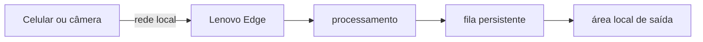
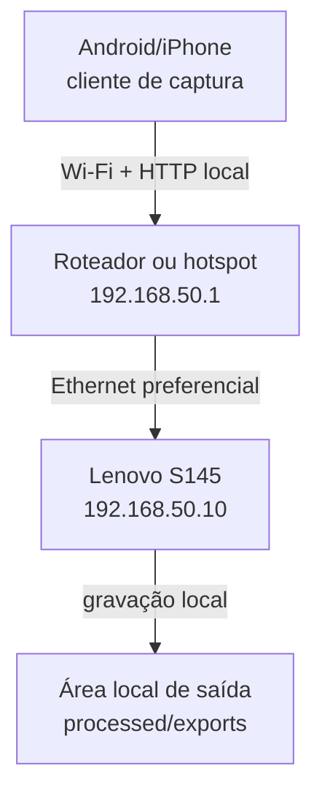
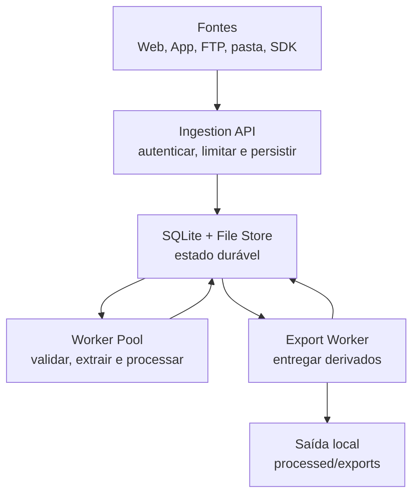
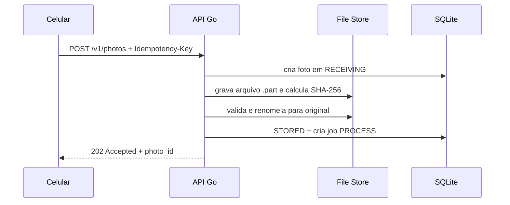
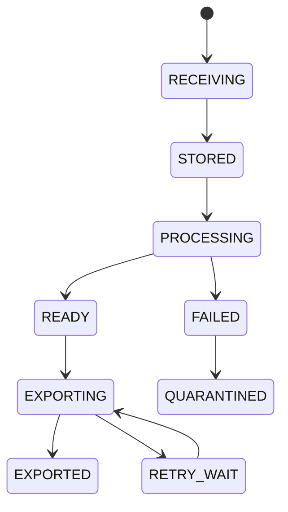
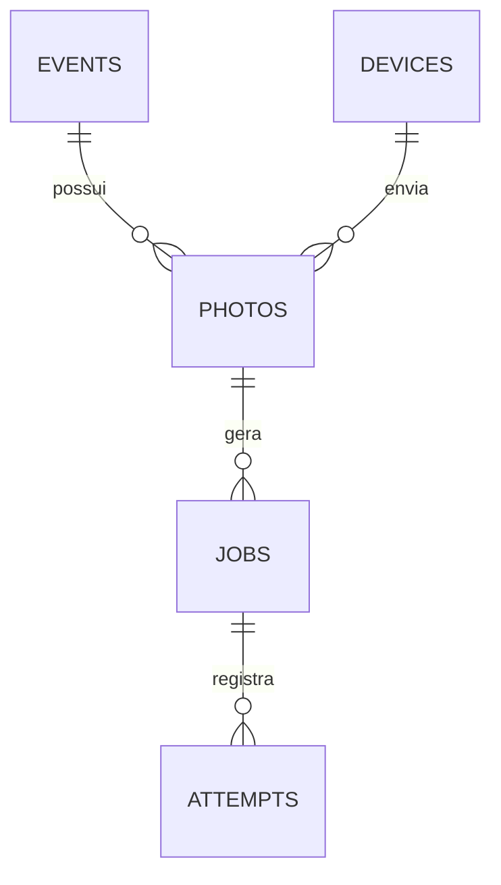
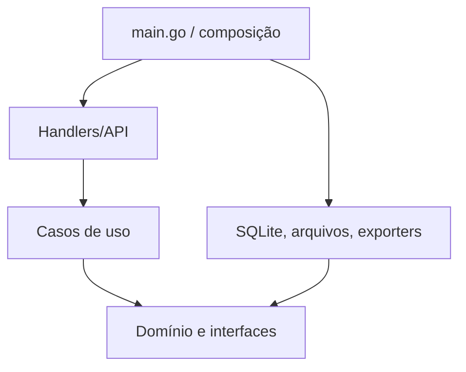

# Photo Edge Orchestrator

## Arquitetura estrutural e especificação do projeto

**Versão do documento:** 1.0  
**Data:** 12 de setembro de 2026  
**Status:** proposta para pré-produção  
**Plataforma Edge:** Lenovo S145  
**Linguagem principal recomendada:** Go  
**Cliente inicial:** navegador móvel; aplicativo Android/iOS na etapa seguinte

---

## 1. Resumo executivo

O **Photo Edge Orchestrator** é um sistema local instalado em um notebook Lenovo S145 para receber fotografias de celulares ou câmeras profissionais, armazená-las com segurança, processá-las de forma assíncrona e disponibilizar os resultados processados em uma área local de saída.

O projeto começa com Android ou iPhone simulando uma câmera profissional. Os dispositivos permanecem na mesma rede local do Lenovo e enviam cada fotografia por HTTP. Depois que a imagem e o trabalho de processamento estiverem gravados de forma durável, o servidor responde `202 Accepted`. A edição, o controle de qualidade e a exportação local acontecem em segundo plano.

A decisão arquitetural central é construir um **monólito modular Edge em Go**, com:

- API HTTP para ingestão;
- armazenamento imutável dos arquivos originais;
- SQLite como fila persistente e banco operacional;
- pool limitado de workers;
- adaptadores independentes para entrada, processamento e exportação local;
- retentativas com backoff;
- recuperação automática após reinicialização;
- métricas, logs estruturados e trilha de auditoria.

> **Resultado esperado:** após o servidor confirmar o recebimento, nenhuma foto aceita deve ser perdida por reinicialização do programa, falha temporária de processamento ou indisponibilidade momentânea do destino local de saída.

---

## 2. Problema e objetivo

### 2.1 Problema

Em fotografia esportiva, as imagens podem ser produzidas mais rapidamente do que conseguem ser editadas, organizadas e entregues ao operador final. Depender de fluxos manuais ou de internet durante o evento cria acoplamento e aumenta o risco de perda, duplicidade ou interrupção do trabalho.

### 2.2 Objetivo geral

Criar uma camada Edge confiável entre a captura e a entrega local dos arquivos processados:



### 2.3 Objetivos específicos

1. Receber várias fotografias simultaneamente sem bloquear o dispositivo de captura.
2. Confirmar somente o que já estiver persistido.
3. Preservar sempre o arquivo original.
4. Processar com concorrência controlada para não saturar o Lenovo.
5. Manter uma fila persistente de processamento e exportação.
6. Evitar derivados duplicados durante retentativas.
7. Permitir trocar celular, FTP ou câmera real sem alterar o núcleo.
8. Registrar tempos, falhas, retentativas e estado de cada foto.
9. Preparar uma evolução gradual, sem introduzir infraestrutura distribuída prematuramente.

### 2.4 Fora do escopo da V1

- reconhecimento facial;
- seleção automática baseada em identidade de atletas;
- edição generativa por IA;
- processamento de RAW de todos os fabricantes;
- cluster de múltiplos servidores Edge;
- aplicativo publicado nas lojas;
- sincronização automática com serviços externos.

---

## 3. Premissas e decisões

| Tema | Decisão inicial | Motivo |
|---|---|---|
| Arquitetura | Monólito modular | Simples de instalar, operar e depurar em um notebook |
| Linguagem | Go | Boa biblioteca HTTP, concorrência simples e binário único |
| Banco e fila | SQLite em WAL | Persistência local com baixa complexidade operacional |
| Arquivos | Sistema de arquivos local | Fotos são blobs grandes; o banco armazena metadados e estados |
| Entrada inicial | Web móvel + `multipart/form-data` | Valida a comunicação sem instalar aplicativo |
| Entrada avançada | Aplicativo Android/iOS | Permite fila no celular, envio contínuo e maior controle |
| Processamento | Worker pool limitado | Protege CPU, RAM, disco e temperatura do Lenovo |
| Exportação | Interface `Exporter` | A entrega da V1 ocorre em área local controlada pelo sistema |
| Confirmação HTTP | `202 Accepted` | A foto foi aceita para processamento, não necessariamente processada |
| Fonte de verdade | SQLite, não canais Go | Reinicializações não podem apagar trabalhos pendentes |
| Escala | Vertical e local primeiro | Redis, RabbitMQ ou PostgreSQL só entram após métricas justificarem |

---

## 4. Arquitetura de implantação

### 4.1 Rede de pré-produção



Configuração sugerida:

| Equipamento | Endereço | Observação |
|---|---:|---|
| Roteador | `192.168.50.1` | DHCP e rede isolada do evento |
| Lenovo | `192.168.50.10` | Reserva DHCP ou IP estático |
| Celular 1 | DHCP | Identificado por credencial, não apenas pelo IP |
| Celular 2+ | DHCP | Cada dispositivo recebe um `device_id` |

Não é necessário abrir portas no roteador para a internet. O Lenovo recebe conexões apenas da LAN e grava os resultados processados em diretórios locais controlados.

### 4.2 Protótipo web versus aplicativo

| Capacidade | Página no navegador | Aplicativo instalado |
|---|---:|---:|
| Abrir câmera e enviar após a captura | Sim | Sim |
| Instalação | Não | Sim |
| Fotografar fora da página e detectar automaticamente | Não | Possível, sujeito às permissões do SO |
| Fila offline no celular | Limitada | Robusta |
| Rajadas e envio contínuo | Limitado | Melhor controle |
| Execução em segundo plano | Muito limitada | Controlada pelo Android/iOS |
| Identidade segura do dispositivo | Básica | Mais robusta |

Na versão web, “upload automático” significa: o usuário toca em **Tirar foto**, o navegador abre a câmera e, assim que retorna o arquivo à página, o JavaScript inicia o `POST` sem exigir um segundo botão de importação. A página não consegue vigiar silenciosamente todas as fotos tiradas no aplicativo nativo da câmera.

---

## 5. Arquitetura lógica



### 5.1 Módulos

| Módulo | Responsabilidade | Não deve fazer |
|---|---|---|
| `api` | Rotas, autenticação, limites, respostas | Editar ou exportar dentro do `POST` |
| `ingestion` | Criar registro, gravar `.part`, validar e finalizar | Conhecer formatos de exportação |
| `filestore` | Caminhos, escrita segura, hash e movimentação | Controlar estados de negócio |
| `repository` | Transações, consultas e migrações SQLite | Processar bytes da imagem |
| `queue` | Reservar jobs, leases, retentativas e recuperação | Usar memória como fonte de verdade |
| `processing` | EXIF, orientação, preset e geração de derivados | Apagar original |
| `exporting` | Interface e adaptadores de saída local | Alterar a imagem original |
| `recovery` | Conciliar estados após falha e limpar temporários | Ignorar arquivos órfãos |
| `telemetry` | Logs, métricas, correlação e auditoria | Registrar tokens ou segredos |

### 5.2 Interfaces de extensão

```go
type PhotoSource interface {
	Name() string
}

type Processor interface {
	Process(ctx context.Context, photo Photo) (Artifact, error)
}

type Exporter interface {
	Export(ctx context.Context, artifact Artifact) (Receipt, error)
}
```

O núcleo não deve saber se a foto veio de Safari, Chrome, FTP ou uma Sony/Canon/Nikon. Da mesma forma, não deve depender de serviços externos para concluir o fluxo da V1.

---

## 6. Fluxo principal de ingestão



### 6.1 Regra de confirmação

O servidor só responde `202` depois de:

1. autenticar o dispositivo;
2. validar os metadados mínimos;
3. criar ou localizar a chave de idempotência;
4. gravar completamente a imagem no disco;
5. calcular o hash;
6. verificar o formato real do arquivo;
7. mover o temporário para o caminho definitivo;
8. registrar a foto e o job persistente no SQLite.

Se a conexão cair antes disso, o cliente pode repetir a mesma requisição com a mesma `Idempotency-Key`. O servidor devolve o mesmo `photo_id` se a operação já tiver sido aceita.

### 6.2 Escrita segura

Fluxo recomendado no disco:

```text
incoming/.tmp/<photo_id>.part
        ↓ escrita em streaming + SHA-256
        ↓ flush/sync
        ↓ validação real do conteúdo
originals/<evento>/<data>/<photo_id>.jpg
```

O nome enviado pelo cliente serve apenas como metadado. O caminho físico usa um identificador criado pelo servidor, impedindo colisões e manipulação de caminho.

### 6.3 Reconciliação após queda

Não existe transação única abrangendo SQLite e sistema de arquivos. Por isso, no início do programa, o módulo `recovery` deve:

- localizar registros presos em `RECEIVING`;
- verificar se o original correspondente existe e se o hash confere;
- completar o job quando o arquivo já estiver válido;
- marcar como falha recuperável quando faltar arquivo;
- remover `.part` antigos apenas após uma janela configurável;
- identificar originais órfãos e colocá-los em quarentena para análise.

---

## 7. Contrato HTTP

### 7.1 Endpoints da V1

| Método | Rota | Finalidade |
|---|---|---|
| `GET` | `/camera` | Interface web responsiva de captura |
| `POST` | `/api/v1/photos` | Receber foto e metadados |
| `GET` | `/api/v1/photos/{id}` | Consultar estado da foto |
| `GET` | `/api/v1/events/{id}/summary` | Resumo do evento e filas |
| `GET` | `/health/live` | Verificar se o processo está vivo |
| `GET` | `/health/ready` | Verificar banco, disco e capacidade de receber |
| `GET` | `/metrics` | Métricas; restrito à máquina ou rede administrativa |

### 7.2 Requisição de ingestão

```http
POST /api/v1/photos HTTP/1.1
Authorization: Bearer <token-do-dispositivo>
Idempotency-Key: camera01-20260912-000345
Content-Type: multipart/form-data; boundary=...

photo=<bytes>
metadata={"event_id":"corrida_001","device_id":"camera_01","captured_at":"2026-09-12T13:32:45.421Z"}
```

### 7.3 Resposta de aceitação

```json
{
  "photo_id": "01K4PHOTOEXAMPLE000000000",
  "status": "queued",
  "received_at": "2026-09-12T13:32:45.870Z",
  "status_url": "/api/v1/photos/01K4PHOTOEXAMPLE000000000"
}
```

### 7.4 Códigos relevantes

| Código | Uso |
|---:|---|
| `202` | armazenada e aceita para processamento assíncrono |
| `400` | metadados inválidos |
| `401` | dispositivo não autenticado |
| `409` | conflito de idempotência: mesma chave com conteúdo diferente |
| `413` | arquivo maior que o limite |
| `415` | formato não aceito |
| `422` | arquivo reconhecido, mas inválido/corrompido |
| `429` | excesso temporário de requisições; cliente deve aguardar |
| `503` | servidor sem capacidade momentânea, banco indisponível ou pouco disco |

Erros devem seguir um formato estável, idealmente compatível com **Problem Details for HTTP APIs**.

---

## 8. Estados e filas persistentes

### 8.1 Máquina de estados da foto



Estados intermediários devem ser observáveis, mas a lógica de execução deve morar em uma tabela de `jobs`. Assim uma mesma foto pode ter jobs separados, por exemplo `PROCESS`, `GENERATE_THUMBNAIL` e `EXPORT`.

### 8.2 Reserva de trabalho com lease

Cada worker:

1. seleciona um job `PENDING` cujo `available_at <= agora`;
2. muda atomicamente para `RUNNING`;
3. grava `lease_owner` e `lease_until`;
4. executa fora da transação;
5. finaliza como `SUCCEEDED`, `RETRY_WAIT` ou `DEAD`;
6. renova o lease se o processamento ultrapassar a duração prevista.

Se o processo morrer, o recovery devolve jobs com lease vencido à fila. O processamento deve ser idempotente: repetir não pode destruir o original nem criar derivados ou registros de exportação duplicados.

### 8.3 Canais Go

Canais podem sinalizar “há trabalho novo” para reduzir polling, porém não armazenam a fila oficial. Na reinicialização, workers consultam o banco e continuam do último estado durável.

---

## 9. Modelo de dados



### 9.1 Tabelas principais

#### `events`

| Campo | Tipo lógico | Observação |
|---|---|---|
| `id` | text/UUID | identificador estável |
| `name` | text | nome do evento |
| `starts_at`, `ends_at` | timestamp UTC | janela do evento |
| `status` | text | `DRAFT`, `ACTIVE`, `CLOSED` |
| `destination_config_id` | text nullable | configuração externa, sem segredo em texto aberto |

#### `devices`

| Campo | Tipo lógico | Observação |
|---|---|---|
| `id` | text | `camera_01`, por exemplo |
| `name` | text | nome amigável |
| `photographer_id` | text nullable | associação operacional |
| `token_hash` | blob/text | nunca salvar o token em claro |
| `enabled` | boolean | revogação imediata |
| `last_seen_at` | timestamp UTC | diagnóstico |

#### `photos`

| Campo | Tipo lógico | Observação |
|---|---|---|
| `id` | text/UUID | criado pelo servidor |
| `event_id`, `device_id` | text | chaves estrangeiras |
| `idempotency_key` | text | única por dispositivo |
| `original_filename` | text | apenas informativo e sanitizado |
| `original_path` | text | caminho controlado pelo servidor |
| `media_type` | text | detectado pelo conteúdo |
| `size_bytes` | integer | limite e auditoria |
| `sha256` | text | integridade e deduplicação auxiliar |
| `captured_at` | timestamp UTC nullable | informado/EXIF; não confiar isoladamente |
| `received_at` | timestamp UTC | relógio do servidor |
| `status` | text | visão consolidada |
| `width`, `height` | integer nullable | preenchidos após validação |
| `exif_json` | text nullable | somente campos permitidos |
| `last_error_code` | text nullable | código estável, sem segredo |

Restrições importantes:

- `UNIQUE(device_id, idempotency_key)`;
- índice em `(event_id, received_at)`;
- índice em `(status, received_at)`;
- `sha256` não deve ser a única chave de idempotência, porque imagens distintas podem intencionalmente ter os mesmos bytes.

#### `jobs`

| Campo | Finalidade |
|---|---|
| `id`, `photo_id`, `kind` | identidade e tipo do trabalho |
| `status` | `PENDING`, `RUNNING`, `RETRY_WAIT`, `SUCCEEDED`, `DEAD` |
| `attempt_count`, `max_attempts` | política de repetição |
| `available_at` | agendamento da próxima tentativa |
| `lease_owner`, `lease_until` | recuperação de worker interrompido |
| `last_error_code`, `last_error_message` | diagnóstico sanitizado |
| `created_at`, `updated_at` | auditoria |

#### `attempts`

Registra início, fim, duração, resultado, código HTTP externo, bytes transmitidos e identificador de correlação. Não registra token, credencial ou conteúdo sensível de resposta.

---

## 10. Layout de armazenamento

```text
data/
├── db/
│   └── orchestrator.db
├── incoming/
│   └── .tmp/
├── originals/
│   └── <event_id>/<yyyy-mm-dd>/<photo_id>.<ext>
├── processed/
│   └── <event_id>/<preset>/<photo_id>.jpg
├── thumbnails/
│   └── <event_id>/<photo_id>.jpg
├── quarantine/
├── exports/
└── backups/
```

Regras:

- original é imutável;
- derivados podem ser recriados;
- banco e arquivos ficam no disco local, não em pasta de rede;
- a exclusão automática só ocorre após exportação local confirmada, prazo de retenção e política aprovada;
- monitorar espaço livre antes de aceitar novas fotos;
- fazer backup consistente do SQLite e dos originais necessários.

---

## 11. Pipeline de processamento


### 11.1 Etapas

1. **Validação:** assinatura real, tamanho, dimensões, decodificação segura e limite de pixels.
2. **Metadados:** leitura controlada de EXIF, orientação, data e dados ópticos úteis.
3. **Normalização:** rotação correta, perfil de cor e conversão de formato quando necessária.
4. **Preset:** resize, crop, nitidez, compressão e marca d'água, se prevista.
5. **Quality gate:** garantir que o derivado abre, tem dimensões esperadas e tamanho aceitável.
6. **Manifesto:** salvar versão do preset, hash do derivado e duração.

### 11.2 Motor de imagem

Na primeira versão, a interface `Processor` pode chamar uma biblioteca Go ou um processo externo bem controlado. Para alto volume, `libvips` é uma opção a avaliar por benchmark. Rust ou C++ somente devem entrar como motor isolado se medições mostrarem gargalo real.

Cada preset deve ser versionado:

```yaml
id: sports-web-v1
output_format: jpeg
max_width: 3000
quality: 88
auto_orient: true
strip_gps: true
watermark: false
```

Reprocessar uma foto com `sports-web-v2` cria um novo derivado; nunca altera o original nem reescreve silenciosamente um resultado de outra versão.

---

## 12. Exportação local e retentativas

### 12.1 Entrega por adaptador

```go
type Exporter interface {
	Export(ctx context.Context, artifact Artifact) (Receipt, error)
	Check(ctx context.Context, receiptID string) (ExportStatus, error)
}
```

Adaptadores possíveis:

- `FolderExportExporter`, para gravar derivados em uma pasta organizada por evento;
- `ManifestExporter`, para gerar manifesto JSON/CSV com metadados, hashes e caminhos;
- `MockExporter`, para testes de sucesso, lentidão e falha.

O destino da V1 é local e controlado pelo próprio sistema, preservando a garantia principal de ingestão, processamento e exportação local.

### 12.2 Política de erro

| Falha | Ação |
|---|---|
| arquivo de saída bloqueado, timeout local, falha transitória de disco | retentar com backoff exponencial e jitter |
| destino local temporariamente indisponível | pausar exportação e manter jobs pendentes |
| permissão negada | pausar destino e solicitar correção operacional |
| artefato inválido | marcar falha permanente para análise |
| recibo local incerto após cópia | conferir manifesto, hash e caminho antes de repetir |
| disco cheio | interromper novas ingestões com erro operacional claro |

Exemplo conceitual de backoff:

```text
atraso = min(limite, base × 2^tentativa) + jitter_aleatório
```

O limite, número máximo e janela de retentativa são configuração operacional, não constantes espalhadas no código.

---

## 13. Concorrência, capacidade e backpressure

### 13.1 Pools separados

- ingestão: streaming concorrente com limite global e por dispositivo;
- processamento: poucos workers, ajustados à CPU e memória;
- exportação: concorrência independente, ajustada ao disco e ao formato de saída.

Separar pools impede exportação lenta de bloquear edição e impede edição pesada de bloquear recebimento.

### 13.2 Controles

- limite de corpo por requisição;
- semáforo para uploads simultâneos;
- fila persistente com tamanho observável;
- limites de jobs por tipo;
- timeouts de leitura, escrita, cabeçalho e operações locais de exportação;
- encerramento gracioso;
- limiar mínimo de espaço livre;
- `429` ou `503` quando não houver capacidade segura.

### 13.3 Dimensionamento

Use medições, não estimativas isoladas:

```text
entrada_bytes_por_segundo = fotos_por_segundo × tamanho_médio_da_foto
backlog_bytes = entrada_acumulada − processamento/exportação concluídos
autonomia_offline = espaço_reservado_para_fila ÷ entrada_bytes_por_segundo
```

Metas iniciais de validação — hipóteses, não garantias:

| Meta | Critério |
|---|---|
| Durabilidade | 0 perda de fotos que já receberam `202` |
| Duplicidade | 0 derivado/exportação duplicada em retentativa controlada |
| Ingestão LAN | p95 abaixo de 1 segundo após terminar a transferência |
| Rajada | sustentar 5 fotos/s por 60 s sem travar |
| Recuperação | reiniciar e retomar todos os jobs pendentes |
| Operação local | receber e processar mesmo sem internet |

Os números finais devem vir do tamanho real das fotos, CPU, RAM, SSD/HDD, preset e velocidade de upload do Lenovo.

---

## 14. Segurança e privacidade

### 14.1 Rede

- rede própria do evento, com WPA2/WPA3 e senha forte;
- Lenovo preferencialmente conectado por Ethernet;
- firewall permitindo a porta da API somente na interface privada;
- nenhuma porta encaminhada da internet para o Lenovo;
- painel administrativo separado ou restrito a `localhost`;
- HTTPS obrigatório quando o tráfego sair da rede confiável.

Para a prova de conceito, HTTP pode ser usado em uma LAN isolada. Aplicativos móveis de produção devem usar TLS; Android e iOS aplicam políticas específicas a tráfego local e conexões em texto claro.

### 14.2 Autenticação e segredos

- token diferente por dispositivo;
- armazenar somente hash do token local;
- revogar dispositivo sem reiniciar o sistema;
- segredos operacionais em cofre do SO ou variável protegida, nunca no repositório;
- não incluir segredos em logs, URLs ou mensagens de erro;
- rotacionar credenciais e registrar quem alterou configurações.

### 14.3 Upload seguro

- allowlist de formatos necessários;
- verificar assinatura/magic bytes, não confiar em extensão ou `Content-Type`;
- gerar nome físico no servidor;
- limitar bytes, dimensões e pixels decodificados;
- armazenar fora de diretório executável/publicamente servido;
- tratar EXIF como entrada não confiável;
- aplicar versão segura do decodificador;
- colocar arquivos suspeitos em quarentena.

### 14.4 LGPD

Fotografias de pessoas identificadas ou identificáveis podem envolver dados pessoais. Antes da produção, documentar:

- finalidade e hipótese legal aplicável;
- papéis de controlador, operador e suboperadores;
- aviso aos participantes do evento;
- minimização de metadados, especialmente GPS;
- prazos de retenção e descarte;
- controle de acesso e trilha de auditoria;
- atendimento aos direitos dos titulares;
- transferência, exportação e eventual compartilhamento posterior das fotos;
- resposta a incidentes e registro das operações.

Esta arquitetura auxilia controles técnicos, mas não determina sozinha a conformidade jurídica de cada evento.

---

## 15. Observabilidade

### 15.1 Logs estruturados

Cada evento de log deve conter, quando aplicável:

```json
{
  "timestamp": "2026-09-12T13:32:45.870Z",
  "level": "INFO",
  "component": "ingestion",
  "event": "photo_accepted",
  "request_id": "req_...",
  "photo_id": "01K4...",
  "device_id": "camera_01",
  "duration_ms": 418,
  "size_bytes": 7340032
}
```

### 15.2 Métricas mínimas

| Métrica | Tipo | Utilidade |
|---|---|---|
| `photos_received_total` | contador | volume de entrada |
| `photos_rejected_total{reason}` | contador | erros de cliente/capacidade |
| `ingestion_duration_seconds` | histograma | latência da ingestão |
| `jobs_pending{kind}` | gauge | backlog |
| `job_duration_seconds{kind}` | histograma | gargalos |
| `job_retries_total{kind,reason}` | contador | instabilidade |
| `export_total{destination,result}` | contador | resultado da exportação local |
| `disk_free_bytes` | gauge | risco de parada |
| `oldest_pending_job_seconds` | gauge | idade real da fila |

Alertas locais importantes: pouco disco, fila crescendo continuamente, destino local indisponível, jobs mortos e banco indisponível.

### 15.3 Correlação

Um `request_id` identifica a tentativa HTTP; `photo_id` acompanha a foto por todo o pipeline; `job_id` acompanha cada trabalho; `receipt_id` registra o recibo local de exportação. Esses identificadores permitem reconstruir a história sem registrar conteúdo sensível.

---

## 16. Estrutura do repositório

```text
photo-edge-orchestrator/
├── cmd/
│   └── edge/
│       └── main.go
├── internal/
│   ├── api/
│   ├── auth/
│   ├── config/
│   ├── domain/
│   ├── ingestion/
│   ├── filestore/
│   ├── repository/
│   │   └── sqlite/
│   ├── queue/
│   ├── processing/
│   ├── exporting/
│   │   ├── mock/
│   │   └── folderexport/
│   ├── recovery/
│   └── telemetry/
├── migrations/
├── web/
│   └── camera/
├── configs/
│   └── config.example.yaml
├── tests/
│   ├── integration/
│   ├── e2e/
│   └── load/
├── scripts/
├── docs/
└── go.mod
```

### 16.1 Regras de dependência



O domínio define interfaces; infraestrutura as implementa. `main.go` compõe dependências. Módulos não acessam o SQLite diretamente fora do repositório.

---

## 17. Configuração

Exemplo sem segredos:

```yaml
server:
  bind: 192.168.50.10:8000
  max_upload_mb: 30
  read_timeout: 30s
  write_timeout: 10s

storage:
  root: ./data
  min_free_gb: 20
  sqlite_path: ./data/db/orchestrator.db
  sqlite_wal: true

workers:
  processing: 2
  exporting: 2
  lease_duration: 2m

retry:
  base_delay: 2s
  max_delay: 10m
  max_attempts: 20

privacy:
  preserve_original: true
  strip_gps_from_derivatives: true
```

Configuração inválida deve impedir o início com mensagem clara. Segredos são referenciados por nome, não colocados no YAML.

---

## 18. Operação e ciclo de vida

### 18.1 Inicialização

1. carregar e validar configuração;
2. abrir logs;
3. verificar diretórios e espaço livre;
4. abrir SQLite e aplicar migrações compatíveis;
5. executar reconciliação;
6. iniciar workers;
7. abrir API;
8. marcar readiness como saudável.

### 18.2 Encerramento

1. retirar readiness;
2. parar de aceitar novas ingestões;
3. concluir requisições ativas dentro do prazo;
4. cancelar ou devolver leases com segurança;
5. finalizar workers;
6. sincronizar logs e fechar banco.

O pacote `net/http` de Go fornece encerramento gracioso por contexto, o que deve ser usado tanto no serviço do Linux quanto no Windows.

### 18.3 Empacotamento

Para V1:

- um binário Go;
- arquivos estáticos incorporados com `embed`;
- SQLite e pastas locais;
- execução como `systemd` no Linux ou serviço no Windows;
- arquivo de configuração externo;
- atualização com backup, migração e rollback documentados.

Docker é opcional. Em um único Lenovo, um serviço nativo tende a simplificar acesso ao disco, diagnóstico e inicialização automática.

---

## 19. Estratégia de testes

### 19.1 Pirâmide de testes

| Nível | Exemplos |
|---|---|
| Unidade | idempotência, backoff, caminhos, transições de estado |
| Integração | SQLite real, gravação `.part`, recuperação de lease |
| HTTP | limites, autenticação, `202`, `409`, `413`, `415` |
| Processamento | golden files, orientação EXIF, imagem corrompida |
| Exportação | mock com timeout, destino local indisponível e recibo incerto |
| E2E | celular/simulador → Lenovo → derivado → exportação local |
| Carga | 1, 5 e 10 fotos/s com tamanhos variados |
| Resiliência | queda de rede, processo encerrado e reinicialização |

### 19.2 Cenários obrigatórios

1. repetir a mesma `Idempotency-Key` com os mesmos bytes;
2. repetir a mesma chave com bytes diferentes;
3. interromper upload pela metade;
4. matar o processo após gravar arquivo e antes de criar job;
5. matar durante processamento;
6. indisponibilizar temporariamente o diretório de exportação;
7. simular falha transitória de cópia local;
8. atingir o limite de disco configurado;
9. enviar extensão `.jpg` com conteúdo inválido;
10. reiniciar e conferir que todos os `202` chegam a estado final.

### 19.3 Simulador de carga

O diretório `tests/load` deve conter um cliente Go capaz de enviar uma pasta de fotos com:

- taxa fixa ou rajada;
- múltiplos `device_id`;
- chaves idempotentes reproduzíveis;
- latência e taxa de erro;
- repetição intencional;
- desconexão e retomada.

O relatório deve medir throughput, p50/p95/p99, uso de CPU/RAM/disco, tamanho máximo do backlog e tempo para drenar a fila.

---

## 20. Plano de execução

### Fase 0 — validação técnica

**Entregáveis:** spike HTTP, gravação em streaming, teste real Android/iPhone e benchmark de disco.  
**Saída:** decisão confirmada sobre navegador, formatos JPEG/HEIC e tamanho máximo.

### Fase 1 — ingestão durável

**Entregáveis:** `/camera`, `POST /photos`, autenticação simples, idempotência, SQLite, `.part`, hash, status e recuperação.  
**Critério:** nenhuma perda dos uploads que receberam `202` em teste de reinício.

### Fase 2 — processamento

**Entregáveis:** worker pool, EXIF, orientação, preset versionado, derivado e quarentena.  
**Critério:** imagens de teste geram resultados determinísticos e o original permanece igual.

### Fase 3 — exportação resiliente

**Entregáveis:** `MockExporter`, exportação em pasta, manifesto, backoff, jitter e recibos locais.  
**Critério:** fila acumula quando a saída local está indisponível e drena quando o destino retorna.

### Fase 4 — observabilidade e carga

**Entregáveis:** dashboard local, métricas, logs, simulador e relatório do Lenovo.  
**Critério:** limites operacionais conhecidos e alertas testados.

### Fase 5 — aplicativo e câmera real

**Entregáveis:** app móvel com fila local ou adaptador FTP/SDK da câmera escolhida.  
**Critério:** trocar a fonte sem modificar ingestão, jobs, processamento e exportação.

---

## 21. Critérios de aceite da pré-produção

- [ ] Android e iPhone conseguem acessar o Lenovo na mesma LAN.
- [ ] A captura web envia automaticamente ao retornar da câmera.
- [ ] O servidor rejeita arquivo inválido e arquivo acima do limite.
- [ ] Cada foto aceita recebe `photo_id` e pode ser consultada.
- [ ] Retentativa do cliente não duplica o registro.
- [ ] Original é preservado e hash conferido.
- [ ] Reinício recupera jobs pendentes.
- [ ] Internet pode cair sem impedir ingestão e processamento local.
- [ ] Exportação local retoma sem duplicar derivados.
- [ ] Pouco disco interrompe ingestão antes de corrupção.
- [ ] Logs permitem seguir `request_id → photo_id → job_id → receipt_id`.
- [ ] Relatório de carga define capacidade segura do Lenovo.
- [ ] Retenção, acesso e compartilhamento de fotos foram documentados.

---

## 22. Riscos e decisões em aberto

| Risco/pergunta | Impacto | Próxima ação |
|---|---|---|
| iPhone pode produzir HEIC | incompatibilidade no pipeline | decidir JPEG obrigatório ou conversão testada |
| Lenovo pode usar HDD lento | ingestão/backlog | benchmark de escrita e considerar SSD |
| Wi-Fi congestionado no evento | latência e perda de conexão | roteador próprio e Lenovo por Ethernet |
| relógio dos celulares incorreto | ordenação errada | manter `received_at` e sincronizar dispositivos |
| rajadas maiores que o processamento | disco cresce | backpressure, métricas e reserva de capacidade |
| SQLite com muitos writers | contenção | um padrão disciplinado de transações curtas |
| EXIF contém GPS | risco de privacidade | remover GPS dos derivados por padrão |
| recibo local incerto | duplicidade | conferir manifesto, hash e caminho antes de repetir |

---

## 23. Evolução arquitetural

Somente evoluir após observar métricas:

| Sinal observado | Evolução possível |
|---|---|
| processamento domina CPU | motor libvips/Rust/C++ separado |
| um Lenovo não atende volume | múltiplos nós Edge por evento |
| SQLite apresenta contenção mensurável | PostgreSQL local/central, após avaliação operacional |
| fila precisa cruzar máquinas | NATS/RabbitMQ/Redis Streams |
| operação futura exige nuvem central | serviço de sincronização Edge–Cloud |
| modelos de IA precisam de GPU | worker dedicado com GPU |

Não substituir componentes apenas por possibilidade futura. O contrato entre módulos e os testes de comportamento devem permitir a troca quando houver evidência.

---

## 24. Conteúdo para aprofundamento

### Trilha A — Go para o orquestrador

1. `net/http`: handlers, servidor, timeouts, multipart e shutdown.
2. `context`: cancelamento e deadlines.
3. goroutines, channels e worker pools limitados.
4. `database/sql`: transações, pool e tratamento de erros.
5. `log/slog`: logs estruturados.
6. testes HTTP, race detector, benchmarks e fuzzing.

### Trilha B — confiabilidade

1. idempotência;
2. at-least-once delivery;
3. leases e recuperação de jobs;
4. backoff exponencial com jitter;
5. backpressure e load shedding;
6. reconciliação entre banco e arquivos;
7. graceful shutdown.

### Trilha C — imagens

1. JPEG/HEIC e perfis de cor;
2. orientação e metadados EXIF;
3. limites de pixels e decompression bombs;
4. resize, crop e qualidade JPEG;
5. preservação do original;
6. benchmark com libvips e alternativas.

### Trilha D — Edge e operação

1. rede LAN, DHCP reservado e firewall;
2. espaço em disco e retenção;
3. logs, métricas e traces;
4. testes de falha e recuperação;
5. atualização, backup e rollback;
6. segurança e proteção de dados desde a concepção.

---

## 25. Referências

Fontes técnicas consultadas e recomendadas para aprofundamento. O documento resume os conceitos; as fontes abaixo são as referências normativas ou oficiais.

### Go

1. Go Project. [Package `net/http`](https://pkg.go.dev/net/http) — servidor/cliente HTTP, timeouts e `Server.Shutdown`.
2. Go Project. [Effective Go](https://go.dev/doc/effective_go) — convenções, concorrência e estilo idiomático; o próprio documento informa que não cobre todas as evoluções recentes.
3. Go Project. [Package `context`](https://pkg.go.dev/context) — cancelamento, deadlines e valores vinculados a requisições.
4. Go Project. [Package `database/sql`](https://pkg.go.dev/database/sql) — interface de banco, transações e pool de conexões.
5. Go Project. [Package `log/slog`](https://pkg.go.dev/log/slog) — logging estruturado.
6. Go Project. [Data Race Detector](https://go.dev/doc/articles/race_detector) — detecção de condições de corrida.

### HTTP e contratos

7. IETF. [RFC 9110 — HTTP Semantics](https://www.rfc-editor.org/rfc/rfc9110.html) — semântica de métodos, `202 Accepted`, `413`, `415`, `429`, `503` e `Retry-After`.
8. IETF. [RFC 9457 — Problem Details for HTTP APIs](https://www.rfc-editor.org/rfc/rfc9457.html) — formato interoperável de erros HTTP.
9. MDN. [`<input type="file">`](https://developer.mozilla.org/en-US/docs/Web/HTML/Reference/Elements/input/file) — seleção/captura de arquivo no navegador móvel.
10. MDN. [`FormData`](https://developer.mozilla.org/en-US/docs/Web/API/FormData) — envio `multipart/form-data` pelo navegador.

### SQLite e persistência

11. SQLite Project. [Write-Ahead Logging](https://sqlite.org/wal.html) — funcionamento, concorrência e limitações do WAL.
12. SQLite Project. [Atomic Commit](https://sqlite.org/atomiccommit.html) — atomicidade e interação com o sistema de arquivos.
13. SQLite Project. [Transaction](https://sqlite.org/lang_transaction.html) — transações e bloqueios.
14. SQLite Project. [Backup API](https://sqlite.org/backup.html) — cópia consistente de banco em uso.

### Segurança e dispositivos móveis

15. OWASP. [File Upload Cheat Sheet](https://cheatsheetseries.owasp.org/cheatsheets/File_Upload_Cheat_Sheet.html) — validação, limites, nomes e armazenamento seguro.
16. OWASP. [REST Security Cheat Sheet](https://cheatsheetseries.owasp.org/cheatsheets/REST_Security_Cheat_Sheet.html) — autenticação, autorização, TLS e validação.
17. Apple Developer. [TN3179: Understanding local network privacy](https://developer.apple.com/documentation/technotes/tn3179-understanding-local-network-privacy) — permissões e comportamento de rede local no iOS.
18. Android Developers. [Network security configuration](https://developer.android.com/privacy-and-security/security-config) — configuração de confiança e política de tráfego do aplicativo.

### Observabilidade e processamento

19. OpenTelemetry. [Signals](https://opentelemetry.io/docs/concepts/signals/) — traces, métricas, logs e baggage.
20. Prometheus. [Metric and label naming](https://prometheus.io/docs/practices/naming/) — convenções para métricas.
21. libvips. [Documentation](https://www.libvips.org/API/current/) — processamento de imagens e operações disponíveis.

### Proteção de dados no Brasil

22. Brasil. [Lei nº 13.709/2018 — LGPD, texto compilado](https://www.planalto.gov.br/ccivil_03/_ato2015-2018/2018/lei/l13709compilado.htm).
23. ANPD. [Guia orientativo sobre segurança da informação para agentes de tratamento de pequeno porte](https://www.gov.br/anpd/pt-br/centrais-de-conteudo/materiais-educativos-e-publicacoes/guia-orientativo-sobre-seguranca-da-informacao-para-agentes-de-tratamento-de-pequeno-porte).
24. ANPD. [Materiais educativos e publicações](https://www.gov.br/anpd/pt-br/centrais-de-conteudo/materiais-educativos-e-publicacoes).

---

## 26. Conclusão

A V1 deve ser um **servidor Edge local, durável e modular**, não um conjunto de uploads síncronos. Go coordena rede, arquivos, filas e workers; SQLite preserva estados; o sistema de arquivos mantém originais; adaptadores isolam fontes de captura, processamento e exportação local.

O celular valida o caminho completo antes da compra da câmera profissional. Primeiro, a página móvel envia automaticamente após a captura. Depois, um app oferece fila local e comportamento mais próximo de uma câmera. Finalmente, FTP ou SDK substitui apenas a fonte, mantendo o restante do sistema.

A ordem técnica recomendada é:

```text
ingestão durável
→ idempotência
→ recuperação
→ processamento
→ exportação resiliente
→ observabilidade
→ teste de carga
→ aplicativo/câmera real
```

Essa sequência reduz risco e produz evidência concreta sobre capacidade, gargalos e necessidades de evolução.
