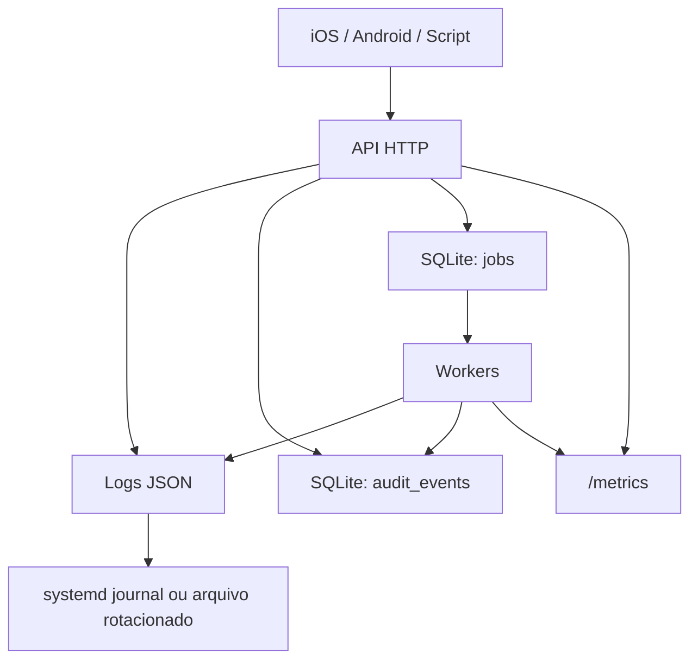
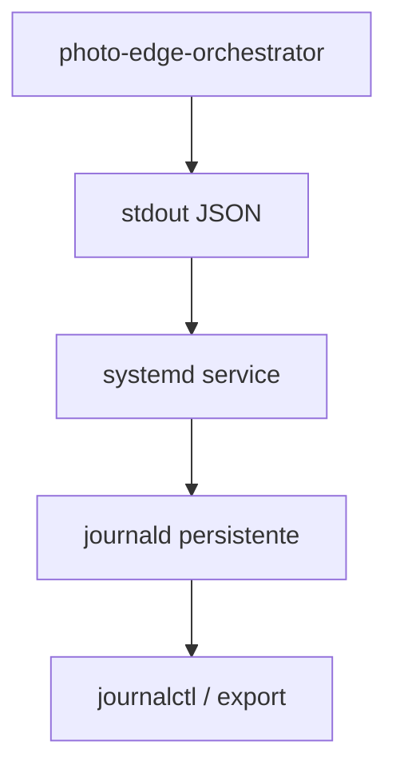
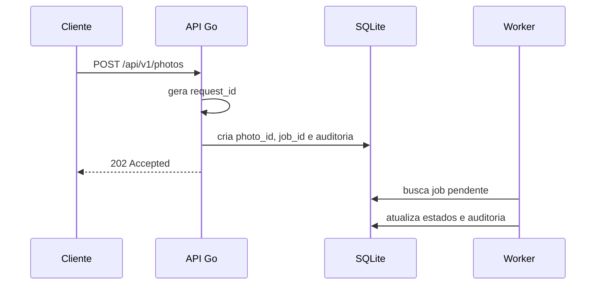

# Arquitetura robusta de logs

Projeto: Photo Edge Orchestrator  
Contexto: servidor local em Go recebendo fotos de iOS, Android, scripts de teste e futuramente câmeras profissionais.

## Objetivo

Antes dos testes de robustez, o projeto precisa conseguir responder três perguntas rapidamente:

1. A foto chegou ao servidor?
2. Ela foi persistida antes do `202 Accepted`?
3. Se falhou, em qual etapa, por qual motivo e se haverá retentativa?

Para isso, a observabilidade deve ser dividida em três camadas:

| Camada | Função | Onde fica |
| --- | --- | --- |
| Logs estruturados | Diagnóstico técnico e linha do tempo | `stdout` em JSON, coletado pelo serviço local |
| Auditoria persistente | Fonte de verdade do ciclo de vida da foto | SQLite |
| Métricas | Saúde, volume, latência e gargalos | Endpoint local `/metrics` |

Os logs explicam o que aconteceu. A auditoria prova o estado da foto. As métricas mostram se o sistema está saudável.

## Visão geral



## Princípios

1. Log deve ser estruturado em JSON.
2. Log não deve ser fonte de verdade do negócio.
3. Eventos importantes devem ser gravados também em auditoria no SQLite.
4. Cada foto deve possuir IDs rastreáveis do início ao fim.
5. Nenhum segredo deve aparecer em logs.
6. O servidor deve conseguir reiniciar e continuar explicando o estado das filas.
7. Testes automatizados devem validar logs, auditoria e métricas.

## Decisão recomendada

Para Go, use `log/slog` com `JSONHandler`.

O aplicativo deve escrever logs em `stdout`. O sistema operacional coleta esses logs:



Essa abordagem evita o aplicativo tentar gerenciar arquivo de log, rotação, compressão e retenção por conta própria.

Em ambiente sem `systemd`, use arquivo local com rotação:

| Ambiente | Coleta recomendada |
| --- | --- |
| Linux com `systemd` | `stdout` + `journald` persistente |
| Windows | `stdout` + arquivo rotacionado ou Windows Event Log |
| Execução manual | `stdout` JSON redirecionado para arquivo |
| Docker futuro | `stdout` JSON coletado pelo runtime |

## Identificadores de correlação

Toda requisição, foto e job precisa carregar identificadores.

| Campo | Escopo | Finalidade |
| --- | --- | --- |
| `request_id` | Tentativa HTTP | Rastrear uma chamada específica |
| `photo_id` | Foto | Acompanhar a foto em todo o ciclo |
| `job_id` | Trabalho assíncrono | Rastrear processamento e publicação |
| `event_id` | Evento esportivo | Agrupar lote de fotos |
| `camera_id` | Dispositivo | Identificar origem |
| `idempotency_key_hash` | Reenvio seguro | Detectar repetição sem expor a chave |

Fluxo ideal:



## Campos obrigatórios do log

Todo evento de log deve ter, no mínimo:

| Campo | Exemplo | Observação |
| --- | --- | --- |
| `time` | `2026-09-13T14:20:31.120Z` | UTC |
| `level` | `INFO` | `DEBUG`, `INFO`, `WARN`, `ERROR` |
| `event` | `photo.accepted` | Nome estável do evento |
| `msg` | `photo accepted` | Mensagem curta |
| `service` | `photo-edge-orchestrator` | Nome do serviço |
| `version` | `0.1.0` | Versão do binário |
| `instance_id` | `lenovo-s145-01` | Identidade local |
| `component` | `ingestion_api` | Área responsável |

Campos contextuais:

| Campo | Quando usar |
| --- | --- |
| `request_id` | Sempre que houver HTTP |
| `photo_id` | Depois da criação da foto |
| `job_id` | Em filas e workers |
| `event_id` | Ao receber ou consultar evento |
| `camera_id` | Ao identificar origem |
| `attempt` | Em retries |
| `duration_ms` | Em operações medidas |
| `status_code` | Ao finalizar HTTP |
| `error_code` | Em erro conhecido |
| `bytes` | Tamanho do arquivo |
| `mime_type` | Validação de mídia |
| `sha256_prefix` | Identificação parcial sem expor conteúdo completo |

## Exemplo de log JSON

```json
{
  "time": "2026-09-13T14:20:31.120Z",
  "level": "INFO",
  "event": "photo.accepted",
  "msg": "photo accepted",
  "service": "photo-edge-orchestrator",
  "version": "0.1.0",
  "instance_id": "lenovo-s145-01",
  "component": "ingestion_api",
  "request_id": "req_01K4ZK7V8NQ2",
  "photo_id": "pho_01K4ZK7W0C3Y",
  "job_id": "job_01K4ZK7W2K8P",
  "event_id": "corrida_001",
  "camera_id": "iphone_01",
  "status_code": 202,
  "bytes": 2842211,
  "mime_type": "image/jpeg",
  "duration_ms": 94
}
```

## Eventos recomendados

### API HTTP

| Evento | Nível | Quando ocorre |
| --- | --- | --- |
| `http.request_started` | `DEBUG` | Entrada da requisição |
| `http.request_completed` | `INFO` | Final da requisição |
| `auth.failed` | `WARN` | Bearer token inválido |
| `idempotency.replayed` | `INFO` | Reenvio reconhecido |
| `photo.validation_failed` | `WARN` | JPEG inválido, tamanho, campo ausente |
| `photo.persisted` | `INFO` | Arquivo original salvo em disco |
| `photo.accepted` | `INFO` | Foto persistida e job criado antes do `202` |

### Fila e workers

| Evento | Nível | Quando ocorre |
| --- | --- | --- |
| `job.queued` | `INFO` | Job inserido na fila persistente |
| `job.lease_acquired` | `DEBUG` | Worker reservou o job |
| `job.started` | `INFO` | Processamento começou |
| `job.completed` | `INFO` | Processamento terminou |
| `job.retry_scheduled` | `WARN` | Falha recuperável com nova tentativa |
| `job.quarantined` | `ERROR` | Falha permanente ou limite de tentativas |
| `job.recovered_after_restart` | `WARN` | Job preso foi recuperado após restart |

### Armazenamento e banco

| Evento | Nível | Quando ocorre |
| --- | --- | --- |
| `storage.write_failed` | `ERROR` | Falha ao gravar original/processado |
| `storage.low_space` | `WARN` | Disco abaixo do limite mínimo |
| `database.unavailable` | `ERROR` | SQLite indisponível |
| `database.slow_query` | `WARN` | Consulta excedeu limite |

### Ciclo do serviço

| Evento | Nível | Quando ocorre |
| --- | --- | --- |
| `service.started` | `INFO` | Serviço subiu |
| `service.ready` | `INFO` | Pronto para receber fotos |
| `shutdown.started` | `INFO` | Recebeu sinal de parada |
| `shutdown.completed` | `INFO` | Fechou filas, workers e banco |

## Níveis de log

| Nível | Uso |
| --- | --- |
| `DEBUG` | Desenvolvimento local, detalhes de lease, payload sanitizado |
| `INFO` | Fluxo normal: aceitou, enfileirou, processou, exportou |
| `WARN` | Algo degradou, mas o sistema continua: retry, backlog, disco baixo |
| `ERROR` | Operação falhou e exige ação: DB fora, arquivo perdido, job em quarentena |

Em produção local, o padrão deve ser `INFO`. `DEBUG` deve ser habilitado temporariamente.

## Auditoria no SQLite

Logs são diagnósticos. Auditoria é histórico de negócio.

Crie uma tabela `audit_events` para registrar transições importantes.

```sql
CREATE TABLE audit_events (
    id INTEGER PRIMARY KEY AUTOINCREMENT,
    occurred_at TEXT NOT NULL,
    event TEXT NOT NULL,
    photo_id TEXT,
    job_id TEXT,
    request_id TEXT,
    event_id TEXT,
    camera_id TEXT,
    status TEXT,
    error_code TEXT,
    details_json TEXT
);
```

Eventos que devem ir para auditoria:

| Evento | Motivo |
| --- | --- |
| `photo.accepted` | Prova que a foto foi recebida |
| `photo.rejected` | Prova de rejeição controlada |
| `job.queued` | Prova que há trabalho pendente |
| `job.started` | Início de processamento |
| `job.completed` | Conclusão |
| `job.retry_scheduled` | Falha recuperável |
| `job.quarantined` | Falha permanente |
| `photo.exported` | Arquivo final gerado |

Regra importante: o evento `photo.accepted` deve ser gravado na mesma transação lógica que cria a foto e o job.

## Segurança e privacidade

Nunca grave em log:

| Não registrar | Motivo |
| --- | --- |
| `Authorization` | Contém Bearer token |
| Token original | Mesmo em erro |
| `Idempotency-Key` bruta | Pode ser tratada como segredo |
| Bytes da imagem | Volume e privacidade |
| EXIF completo | Pode conter dados sensíveis |
| Caminho absoluto completo | Expõe estrutura da máquina |
| Nome pessoal do fotógrafo | Prefira IDs internos |

Pode registrar:

| Pode registrar | Forma recomendada |
| --- | --- |
| Token | Apenas hash parcial, se necessário |
| Idempotency key | `idempotency_key_hash` |
| Arquivo | `photo_id`, `sha256_prefix`, tamanho e extensão |
| IP local | Opcional, preferencialmente mascarado |
| Dispositivo | `camera_id` controlado pelo sistema |

## Métricas locais

Crie um endpoint `GET /metrics` ou uma página operacional simples.

Métricas mínimas:

| Métrica | Tipo | Objetivo |
| --- | --- | --- |
| `photos_accepted_total` | contador | Fotos aceitas |
| `photos_rejected_total` | contador | Fotos rejeitadas |
| `http_request_duration_ms` | histograma | Latência HTTP |
| `photo_persist_duration_ms` | histograma | Tempo para salvar original |
| `queue_depth` | gauge | Tamanho da fila |
| `jobs_active` | gauge | Workers ocupados |
| `jobs_completed_total` | contador | Jobs concluídos |
| `jobs_failed_total` | contador | Jobs com falha |
| `jobs_quarantined_total` | contador | Jobs em quarentena |
| `storage_free_bytes` | gauge | Espaço livre |
| `sqlite_errors_total` | contador | Erros de banco |

Essas métricas serão a base dos testes de carga via script.

## Health checks

Os endpoints existentes podem ser fortalecidos:

| Endpoint | Deve validar |
| --- | --- |
| `/health/live` | Processo está vivo |
| `/health/ready` | SQLite abre, disco tem espaço, diretórios existem |
| `/metrics` | Estado operacional e contadores |

Critérios recomendados para `/health/ready` retornar `503`:

| Condição | Motivo |
| --- | --- |
| SQLite indisponível | Não é seguro aceitar fotos |
| Diretório `/incoming` sem escrita | Não é possível persistir originais |
| Disco abaixo do limite | Risco de aceitar e perder foto |
| Migração pendente ou falha | Estado de dados incerto |

## Retenção e rotação

Sugestão inicial para ambiente local:

| Item | Retenção |
| --- | --- |
| Logs JSON | 7 a 14 dias |
| Auditoria SQLite | 30 a 90 dias ou por evento |
| Fotos originais | Política por evento |
| Fotos processadas | Política por evento |
| Jobs concluídos | 30 dias |
| Jobs em erro/quarentena | Até investigação |

Para `journald`, habilite persistência e limite de espaço no servidor:

```ini
[Journal]
Storage=persistent
SystemMaxUse=1G
MaxRetentionSec=14day
```

## Fluxo de investigação

Quando uma foto falhar:

1. Buscar `photo_id` na resposta do cliente ou no resumo do evento.
2. Consultar `audit_events` por `photo_id`.
3. Consultar logs JSON pelo mesmo `photo_id`.
4. Verificar `job_id`, tentativas e último `error_code`.
5. Conferir métricas: fila, disco, workers e erros de SQLite.

Comandos úteis no Linux:

```bash
journalctl -u photo-edge-orchestrator --since "30 minutes ago"
journalctl -u photo-edge-orchestrator -o json | jq 'select(.photo_id=="pho_...")'
```

## Integração com testes de robustez

Os testes via script devem validar mais do que o HTTP `202`.

Cada cenário deve verificar:

| Verificação | Fonte |
| --- | --- |
| Recebeu `202 Accepted` | Resposta HTTP |
| Foto foi criada | Tabela `photos` |
| Job foi criado | Tabela `jobs` |
| Auditoria foi gravada | Tabela `audit_events` |
| Log possui `photo.accepted` | Logs JSON |
| Worker processou ou agendou retry | Logs + SQLite |
| Métricas mudaram corretamente | `/metrics` |

Cenários que os logs devem suportar:

| Cenário | O que observar |
| --- | --- |
| 1 foto | Fluxo completo |
| 100 fotos sequenciais | Crescimento controlado da fila |
| 10 fotos em paralelo | Concorrência na API |
| JPEG inválido | Rejeição `415` ou `422` |
| Token inválido | `401` sem vazar token |
| Reenvio com mesma idempotency key | `idempotency.replayed` |
| Disco quase cheio | `/health/ready` degradado |
| Reinício durante processamento | `job.recovered_after_restart` |

## Estrutura sugerida no código Go

```text
internal/
  observability/
    logger.go
    metrics.go
    request_id.go
  audit/
    repository.go
    events.go
  httpapi/
    middleware_logging.go
    middleware_recovery.go
  workers/
    processor.go
    retry.go
```

Responsabilidades:

| Módulo | Responsabilidade |
| --- | --- |
| `observability/logger.go` | Configurar `slog` JSON |
| `observability/request_id.go` | Criar ou propagar `request_id` |
| `observability/metrics.go` | Contadores, gauges e tempos |
| `audit/repository.go` | Gravar eventos persistentes |
| `httpapi/middleware_logging.go` | Logar início/fim de requisição |
| `workers/processor.go` | Logar lifecycle do job |

## Exemplo de uso com `slog`

```go
logger.InfoContext(ctx, "photo accepted",
    "event", "photo.accepted",
    "component", "ingestion_api",
    "request_id", requestID,
    "photo_id", photoID,
    "job_id", jobID,
    "event_id", eventID,
    "camera_id", cameraID,
    "status_code", 202,
    "bytes", fileSize,
    "duration_ms", elapsed.Milliseconds(),
)
```

## Ordem de implementação

1. Criar logger JSON centralizado com `slog`.
2. Criar middleware de `request_id`, duração e status HTTP.
3. Padronizar `event` e `component` em constantes.
4. Criar tabela `audit_events`.
5. Gravar auditoria nas transições críticas.
6. Adicionar métricas mínimas.
7. Fortalecer `/health/ready`.
8. Configurar serviço local com coleta persistente de logs.
9. Criar testes que validam HTTP, SQLite, logs e métricas.

## Resultado esperado

Depois dessa arquitetura, um teste de robustez não apenas dirá:

```text
1000 uploads enviados
998 sucesso
2 falhas
```

Ele deverá explicar:

```text
1000 uploads enviados
1000 fotos persistidas
1000 jobs criados
998 processadas
2 em retry
0 perdidas
0 inconsistências
latência p95 HTTP: 180 ms
latência p95 persistência: 90 ms
maior fila observada: 143 jobs
```

Esse é o ponto em que o projeto deixa de ser apenas funcional e começa a ficar operacionalmente confiável.

## Referências para aprofundamento

| Tema | Referência |
| --- | --- |
| Go `log/slog` | https://pkg.go.dev/log/slog |
| Go `net/http` | https://pkg.go.dev/net/http |
| SQLite WAL | https://www.sqlite.org/wal.html |
| SQLite transactions | https://www.sqlite.org/lang_transaction.html |
| systemd journal | https://www.freedesktop.org/software/systemd/man/latest/systemd-journald.service.html |
| journald config | https://www.freedesktop.org/software/systemd/man/latest/journald.conf.html |
| OWASP Logging Cheat Sheet | https://cheatsheetseries.owasp.org/cheatsheets/Logging_Cheat_Sheet.html |
| OWASP Error Handling | https://cheatsheetseries.owasp.org/cheatsheets/Error_Handling_Cheat_Sheet.html |
| OpenTelemetry Logs | https://opentelemetry.io/docs/concepts/signals/logs/ |
| OpenTelemetry Metrics | https://opentelemetry.io/docs/concepts/signals/metrics/ |
| Prometheus metric types | https://prometheus.io/docs/concepts/metric_types/ |
| RFC 9110 HTTP Semantics | https://www.rfc-editor.org/rfc/rfc9110 |

