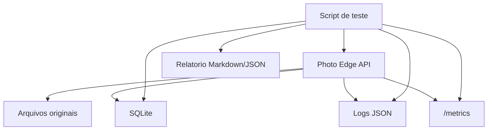

# Plano de testes de robustez via script

Projeto: Photo Edge Orchestrator  
Fase atual: conexão iOS funcionando e estrutura robusta de logs implementada  
Objetivo: validar robustez local sem depender exclusivamente de Android/iOS

## Resumo

Os testes de robustez podem ser feitos majoritariamente via script. O celular continua importante para validar a experiência real, mas scripts conseguem simular volume, concorrência, repetição, falhas esperadas e recuperação com muito mais controle.

A estratégia recomendada é:

1. Enviar fotos por HTTP como o iOS envia.
2. Validar resposta da API.
3. Consultar SQLite.
4. Verificar eventos de auditoria.
5. Verificar logs JSON.
6. Verificar métricas.
7. Gerar relatório do teste.

## Arquitetura dos testes



O script não deve testar apenas o retorno HTTP. Ele deve provar que o sistema preservou consistência interna.

## Escopo inicial

| Escopo | Entra nesta fase |
| --- | --- |
| Upload HTTP multipart | Sim |
| Bearer token | Sim |
| `Idempotency-Key` | Sim |
| JPEG válido | Sim |
| JPEG inválido | Sim |
| Concorrência local | Sim |
| Consulta de SQLite | Sim |
| Verificação de logs JSON | Sim |
| Verificação de métricas | Sim |
| Teste com iPhone real | Complementar |
| Teste com câmera profissional | Futuro |
| Upload cloud | Futuro |

## Estrutura sugerida

```text
tests/
  robustness/
    README.md
    config.example.env
    runner.py
    scenarios/
      smoke.py
      single_upload.py
      sequential_upload.py
      concurrent_upload.py
      invalid_inputs.py
      idempotency.py
      restart_recovery.md
    fixtures/
      valid/
        sample_001.jpg
        sample_002.jpg
      invalid/
        not_image.txt
        corrupt.jpg
    reports/
      .gitkeep
```

## Configuração

Crie um arquivo `.env` local para os testes.

```env
PHOTO_EDGE_BASE_URL=http://127.0.0.1:8000
PHOTO_EDGE_API_TOKEN=trocar-em-ambiente-local
PHOTO_EDGE_EVENT_ID=robustez_local_001
PHOTO_EDGE_CAMERA_ID=script_runner_01
PHOTO_EDGE_DB_PATH=./data/photo_edge.db
PHOTO_EDGE_LOG_PATH=./logs/photo-edge.jsonl
PHOTO_EDGE_TIMEOUT_SECONDS=30
PHOTO_EDGE_POLL_INTERVAL_MS=250
```

O token não deve ser salvo em repositório. O arquivo versionado deve ser apenas `config.example.env`.

## Contrato HTTP esperado

O script deve enviar a foto como `multipart/form-data`.

| Campo | Valor |
| --- | --- |
| Método | `POST` |
| Endpoint | `/api/v1/photos` |
| Header | `Authorization: Bearer <token>` |
| Header | `Idempotency-Key: <uuid>` |
| Campo multipart | `photo` |
| Campo adicional | `event_id` |
| Campo adicional | `camera_id` |

Resposta esperada em caso de aceite:

```json
{
  "photo_id": "pho_...",
  "job_id": "job_...",
  "status": "queued"
}
```

Status HTTP esperado:

| Status | Interpretação |
| --- | --- |
| `202` | Foto aceita e persistida |
| `400` | Requisição malformada |
| `401` | Token inválido |
| `409` | Conflito de idempotência |
| `413` | Arquivo grande demais |
| `415` | Tipo de mídia não aceito |
| `422` | Conteúdo inválido |
| `503` | Servidor indisponível |

## Regras de consistência

Para cada resposta `202`, o teste deve validar:

| Validação | Fonte |
| --- | --- |
| Existe `photo_id` | Resposta HTTP |
| Existe registro em `photos` | SQLite |
| Existe registro em `jobs` | SQLite |
| Existe `photo.accepted` | Auditoria |
| Existe `job.queued` | Auditoria |
| Existe log com `photo_id` | Logs JSON |
| Original existe em disco | Filesystem |
| Status final é válido | API ou SQLite |

Estados finais válidos:

| Estado | Quando aceitar |
| --- | --- |
| `processed` | Processamento concluído |
| `exported` | Arquivo final gerado |
| `retry_scheduled` | Falha recuperável |
| `quarantined` | Falha controlada e rastreável |

Estado proibido:

| Estado | Motivo |
| --- | --- |
| `accepted sem arquivo` | Risco de perda de foto |
| `job sem photo` | Inconsistência relacional |
| `202 sem auditoria` | Falha de rastreabilidade |
| `202 sem log` | Falha de diagnóstico |
| `erro sem error_code` | Falha de observabilidade |

## Cenário 1: smoke test

Objetivo: validar que o servidor está operacional antes de carga.

Passos:

1. Chamar `/health/live`.
2. Chamar `/health/ready`.
3. Chamar `/metrics`.
4. Verificar se SQLite está acessível.
5. Verificar se o arquivo de log recebe novos eventos.

Critério de sucesso:

| Item | Esperado |
| --- | --- |
| `/health/live` | `200` |
| `/health/ready` | `200` |
| `/metrics` | responde |
| SQLite | abre em modo leitura |
| Logs | contém `service.started` ou evento recente |

## Cenário 2: upload único

Objetivo: provar o fluxo completo de uma foto.

Passos:

1. Enviar `sample_001.jpg`.
2. Receber `202`.
3. Capturar `photo_id` e `job_id`.
4. Consultar status até finalização ou timeout.
5. Validar SQLite, auditoria, logs e arquivo.

Critério de sucesso:

| Item | Esperado |
| --- | --- |
| HTTP | `202` |
| Latência HTTP | menor que limite definido |
| Auditoria | `photo.accepted` e `job.queued` |
| Logs | possuem `request_id`, `photo_id`, `job_id` |
| Status final | `processed`, `exported`, `retry_scheduled` ou `quarantined` |

## Cenário 3: uploads sequenciais

Objetivo: validar estabilidade em volume controlado.

Parâmetros sugeridos:

| Parâmetro | Valor inicial |
| --- | --- |
| Fotos | `100` |
| Concorrência | `1` |
| Intervalo | `100 ms` a `1000 ms` |
| Timeout por foto | `30 s` |

Métricas coletadas:

| Métrica | Descrição |
| --- | --- |
| `accepted_total` | Total aceito |
| `rejected_total` | Total rejeitado |
| `http_latency_p50` | Mediana HTTP |
| `http_latency_p95` | P95 HTTP |
| `persist_latency_p95` | P95 de persistência |
| `queue_depth_max` | Maior fila observada |
| `missing_logs` | Fotos aceitas sem log |
| `missing_audit` | Fotos aceitas sem auditoria |

Critério de sucesso:

```text
fotos_perdidas = 0
accepted_total = registros_photos_criados
accepted_total = jobs_criados
missing_logs = 0
missing_audit = 0
```

## Cenário 4: uploads concorrentes

Objetivo: simular vários dispositivos ou rajadas.

Parâmetros sugeridos:

| Parâmetro | Valor inicial |
| --- | --- |
| Fotos | `200` |
| Concorrência | `5`, depois `10`, depois `20` |
| Timeout HTTP | `10 s` |
| Timeout processamento | `120 s` |

O script deve controlar concorrência com pool de workers.

Critério de sucesso:

| Item | Esperado |
| --- | --- |
| Perda de foto | `0` |
| Erro inesperado | `0` |
| `202` sem persistência | `0` |
| Deadlock SQLite | `0` |
| Logs sem `photo_id` | `0` |
| Workers travados | `0` |

## Cenário 5: entradas inválidas

Objetivo: garantir rejeição segura.

Casos:

| Caso | Esperado |
| --- | --- |
| Sem Bearer token | `401` |
| Token inválido | `401` |
| Sem campo `photo` | `400` |
| Campo `photo` vazio | `422` |
| Arquivo `.txt` | `415` ou `422` |
| JPEG corrompido | `422` |
| Arquivo acima do limite | `413` |
| `event_id` ausente | `400` ou regra definida |
| `camera_id` ausente | `400` ou regra definida |

Validações obrigatórias:

1. O erro precisa ter `error_code`.
2. O token nunca deve aparecer no log.
3. O arquivo inválido não deve gerar job de processamento.
4. Rejeições esperadas não devem ser registradas como falha crítica.

## Cenário 6: idempotência

Objetivo: validar reenvio seguro.

Passos:

1. Enviar uma foto com `Idempotency-Key: X`.
2. Reenviar a mesma foto com `Idempotency-Key: X`.
3. Verificar que não criou duplicidade indevida.
4. Verificar log `idempotency.replayed`.

Critério de sucesso:

| Item | Esperado |
| --- | --- |
| Primeira chamada | `202` |
| Segunda chamada | resposta controlada |
| Duplicidade de foto | não ocorre |
| Duplicidade de job | não ocorre |
| Log | `idempotency.replayed` |
| Auditoria | reenvio rastreável |

## Cenário 7: recuperação após reinício

Objetivo: validar jobs com lease preso.

Este cenário pode começar sem automação total.

Passos manuais orientados:

1. Iniciar upload concorrente.
2. Interromper o serviço durante processamento.
3. Subir o serviço novamente.
4. Verificar recuperação de jobs pendentes.
5. Verificar evento `job.recovered_after_restart`.

Critério de sucesso:

| Item | Esperado |
| --- | --- |
| Jobs pendentes | recuperados |
| Jobs em processamento antigo | reprocessados ou reagendados |
| Fotos originais | preservadas |
| Auditoria | contém recuperação |
| Logs | contém `job.recovered_after_restart` |

## Cenário 8: degradação controlada de disco

Objetivo: validar que o servidor não aceita fotos quando não pode persistir com segurança.

Recomendação: não faça teste enchendo o disco real do sistema. Use um diretório temporário controlado, limite configurável ou mock de storage.

Critério de sucesso:

| Item | Esperado |
| --- | --- |
| `/health/ready` | retorna `503` |
| Upload novo | retorna `503` |
| Log | `storage.low_space` |
| Auditoria | não registra foto aceita indevidamente |
| Perda de foto | `0` |

## Saída do relatório

Cada execução deve gerar um relatório em `tests/robustness/reports/`.

Formato sugerido:

```text
reports/
  robustez_2026-09-13_142031.json
  robustez_2026-09-13_142031.md
```

Campos mínimos do relatório JSON:

```json
{
  "scenario": "concurrent_upload",
  "started_at": "2026-09-13T14:20:31Z",
  "finished_at": "2026-09-13T14:23:10Z",
  "base_url": "http://127.0.0.1:8000",
  "photos_sent": 200,
  "photos_accepted": 200,
  "expected_rejections": 0,
  "unexpected_errors": 0,
  "missing_db_rows": 0,
  "missing_jobs": 0,
  "missing_audit_events": 0,
  "missing_log_events": 0,
  "http_latency_ms": {
    "p50": 82,
    "p95": 210,
    "max": 711
  },
  "queue_depth_max": 37,
  "result": "passed"
}
```

## Comandos planejados

Linux/macOS:

```bash
python3 tests/robustness/runner.py --scenario smoke
python3 tests/robustness/runner.py --scenario single-upload --photo tests/robustness/fixtures/valid/sample_001.jpg
python3 tests/robustness/runner.py --scenario sequential-upload --photos 100 --rate 5
python3 tests/robustness/runner.py --scenario concurrent-upload --photos 200 --concurrency 10
python3 tests/robustness/runner.py --scenario invalid-inputs
python3 tests/robustness/runner.py --scenario idempotency
```

Windows PowerShell:

```powershell
.\.venv\Scripts\python.exe tests\robustness\runner.py --scenario smoke
.\.venv\Scripts\python.exe tests\robustness\runner.py --scenario single-upload --photo tests\robustness\fixtures\valid\sample_001.jpg
.\.venv\Scripts\python.exe tests\robustness\runner.py --scenario sequential-upload --photos 100 --rate 5
.\.venv\Scripts\python.exe tests\robustness\runner.py --scenario concurrent-upload --photos 200 --concurrency 10
.\.venv\Scripts\python.exe tests\robustness\runner.py --scenario invalid-inputs
.\.venv\Scripts\python.exe tests\robustness\runner.py --scenario idempotency
```

## Bibliotecas sugeridas para o runner

| Biblioteca | Uso |
| --- | --- |
| `requests` | Upload HTTP simples |
| `httpx` | Upload HTTP síncrono ou assíncrono |
| `python-dotenv` | Ler `.env` |
| `sqlite3` | Consultar SQLite |
| `json` | Ler logs JSONL |
| `statistics` | Calcular médias e percentis simples |
| `concurrent.futures` | Concorrência com threads |
| `asyncio` | Alternativa assíncrona |

Para a primeira versão, `requests` + `ThreadPoolExecutor` já é suficiente.

## Pseudocódigo do runner

```python
def run_upload(photo_path, idempotency_key):
    response = post_photo(photo_path, idempotency_key)
    record_http_result(response)

    if response.status_code == 202:
        photo_id = response.json()["photo_id"]
        assert_photo_exists_in_db(photo_id)
        assert_job_exists_in_db(photo_id)
        assert_audit_event(photo_id, "photo.accepted")
        assert_log_event(photo_id, "photo.accepted")
        wait_until_final_state(photo_id)

    return result
```

## Critérios gerais de aprovação

Um teste de robustez só deve ser considerado aprovado quando:

| Critério | Esperado |
| --- | --- |
| Fotos aceitas sem persistência | `0` |
| Fotos aceitas sem auditoria | `0` |
| Fotos aceitas sem log rastreável | `0` |
| Jobs órfãos | `0` |
| Falhas sem `error_code` | `0` |
| Vazamento de token em log | `0` |
| Travamento do servidor | `0` |
| `/health/ready` após teste | `200` |

## Métricas que devem aparecer no relatório

| Métrica | Por que importa |
| --- | --- |
| Latência HTTP p50/p95/p99 | Mostra experiência de envio |
| Tempo de persistência p95 | Mostra gargalo de disco |
| Throughput fotos/minuto | Mede capacidade local |
| Maior profundidade da fila | Mede pressão nos workers |
| Tempo até estado final | Mede processamento |
| Erros por tipo | Facilita diagnóstico |
| Uso de disco antes/depois | Evita surpresa operacional |

## Ordem de implementação recomendada

1. Criar `tests/robustness/config.example.env`.
2. Criar `runner.py` com cenário `smoke`.
3. Implementar upload único.
4. Implementar leitura de SQLite.
5. Implementar leitura de logs JSONL.
6. Implementar relatório JSON/Markdown.
7. Implementar sequencial.
8. Implementar concorrente.
9. Implementar entradas inválidas.
10. Implementar idempotência.
11. Implementar recuperação após reinício.

## Resultado esperado da primeira entrega

A primeira entrega não precisa cobrir tudo. O mínimo robusto deve conter:

| Entrega | Obrigatório |
| --- | --- |
| `smoke` | Sim |
| `single-upload` | Sim |
| `sequential-upload` | Sim |
| `concurrent-upload` | Sim |
| relatório `.json` | Sim |
| relatório `.md` | Sim |
| validação SQLite | Sim |
| validação logs | Sim |
| validação métricas | Desejável |

## Observação final

O objetivo desses scripts é substituir o teste manual repetitivo, não substituir totalmente o teste real com iOS/Android.

Use scripts para provar carga, consistência e recuperação. Use iOS/Android para validar experiência real de captura, rede Wi-Fi local e comportamento do navegador ou aplicativo.

